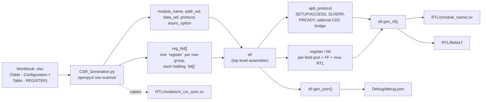
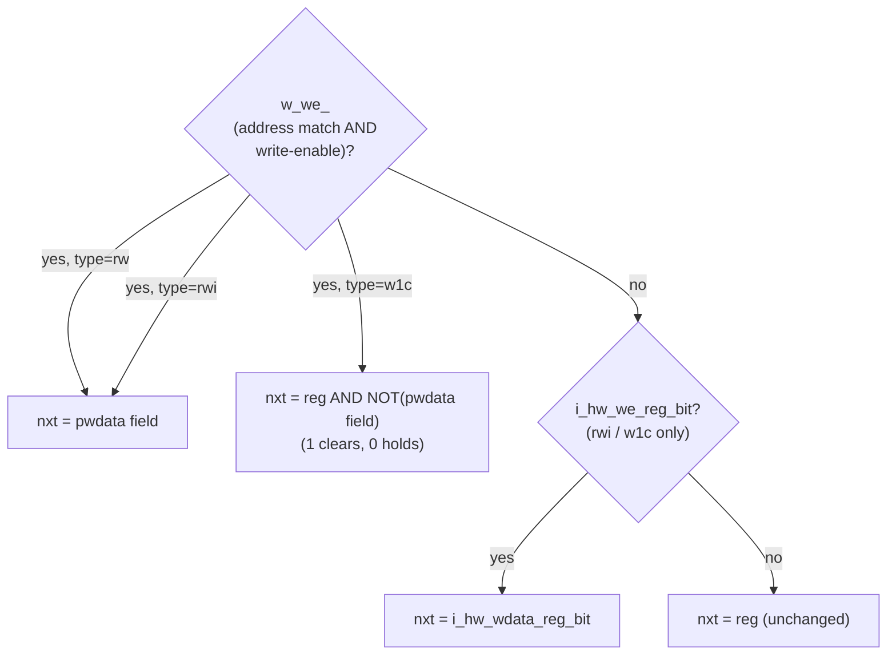
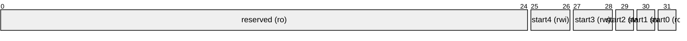

# APB CSR Generation Tool

## Overview

This document describes the **APB-CSR-Generator**, a Python tool that reads a register-map
specification from an Excel workbook and emits a synthesizable SystemVerilog **APB4 slave** module
exposing those registers — address decode, `SLVERR`/`PREADY` handshaking, per-bit read/write/insert/
clear semantics, and (optionally) a full clock-domain-crossing bridge between the APB bus clock and an
independent register clock — with no hand-written RTL required for a new CSR block.

Given a workbook such as `CSR_Example.xlsx`, running the tool produces one `.sv` module, a matching
`filelist.f`, a copy of the CDC synchronizer template it depends on, and a JSON dump of the parsed
configuration for review — see [Generation Workflow](#generation-workflow).

---

## Features

| Feature | Description |
|---------|-------------|
| **Bus Protocol** | APB4 slave (`PSEL`/`PENABLE`/`PREADY`/`PSLVERR`, 2-phase SETUP/ACCESS) |
| **Register Fields** | `rw` (read/write), `ro` (read-only, HW-driven), `rwi` (read/write/insert — SW or HW can update), `w1c` (write-1-to-clear) |
| **Bit-level granularity** | Each register is built from independently-typed bit/field slices — a single 32-bit register can mix `rw`, `ro`, `rwi`, and `w1c` fields |
| **Clock domains** | Single-clock (`Asynchronous=0`, everything on `i_clk_apb`) or dual-clock (`Asynchronous=1`, registers live on an independent `i_clk_reg`, bridged by a 2-flop req/ack handshake) — see [Architecture](#architecture) |
| **Protection / error checking** | Optional `PPROT`-based access protection (`i_protect_en`) and `SLVERR` generation on protection failure, misaligned address, or partial `PSTRB` on a write (`i_slverr_en`) |
| **Address decode** | Auto-generated per register from its workbook-assigned offset (`LPARA_<REG>_OFFSET` localparams) |
| **Input** | A single Excel workbook (`openpyxl`), one sheet per register map |
| **Output** | One `.sv` module + `filelist.f` + CDC synchronizer template + a JSON debug dump of the parsed config |

---

## Interface Signals

### APB Bus Interface (always present)

| Signal | Direction | Description |
|--------|-----------|--------------|
| `i_clk_apb` | Input | APB bus clock |
| `i_rst_n_apb` | Input | APB bus reset, active low |
| `i_apb_psel` | Input | Peripheral select |
| `i_apb_penable` | Input | Enable — low during SETUP, high during ACCESS |
| `i_apb_paddr` | Input | Address (`LPARA_ADDR_W` bits, workbook `Address Width`) |
| `i_apb_pwrite` | Input | 1 = write, 0 = read |
| `i_apb_pwdata` | Input | Write data (`LPARA_DATA_W` bits, workbook `Data Width`) |
| `i_apb_pstrb` | Input | Byte strobes (4 bits) — a write with any strobe bit low is flagged `SLVERR` when `i_slverr_en=1` |
| `i_apb_pprot` | Input | Protection attributes (3 bits, APB4 `PPROT`) |
| `i_protect_en` | Input | 1 = gate `PPROT[1]` (secure/non-secure) into the `SLVERR` check; 0 = protection check disabled |
| `i_slverr_en` | Input | 1 = enable `SLVERR` generation (protection/alignment/strobe checks); 0 = always respond `OKAY` |
| `o_apb_pready` | Output | Transfer ready |
| `o_apb_pslverr` | Output | Slave error response |
| `o_apb_prdata` | Output | Read data (`LPARA_DATA_W` bits) |

### Register Clock Interface (only when `Asynchronous=1`)

| Signal | Direction | Description |
|--------|-----------|--------------|
| `i_clk_reg` | Input | Independent register-bank clock |
| `i_rst_n_reg` | Input | Register-bank reset, active low |

### Per-Register, Per-Bit Ports (generated per field, named `<reg>_<bit>`)

| Field Type | Generated Ports |
|------------|------------------|
| `ro` | `i_<reg>_<bit>` (input) — the register value is a direct passthrough of this port, no flop |
| `rw` | `o_<reg>_<bit>` (output) — SW-writable, reads back the last SW write |
| `rwi` | `o_<reg>_<bit>` (output), `i_hw_wdata_<reg>_<bit>` (input), `i_hw_we_<reg>_<bit>` (input, 1 bit) — SW write takes priority over a same-cycle HW write |
| `w1c` | `o_<reg>_<bit>` (output), `i_hw_wdata_<reg>_<bit>` (input), `i_hw_we_<reg>_<bit>` (input, 1 bit) — a SW write of `1` clears the bit; HW can independently set it via `i_hw_we_*`/`i_hw_wdata_*` |

A field named `reserved` gets no ports at all — it reads back as `0` and ignores writes.

---

## Architecture

**[Open the interactive architecture diagram](docs/architecture.html)** — a self-contained,
colorful HTML page (no build step, no CDN) covering the generated module's block-level dataflow: APB
decode/capture, the CDC handshake bridge, the per-register banks, and the `PRDATA` mux/resync path.
Blocks are colored by clock domain (`i_clk_apb` / bridges both / `i_clk_reg`) rather than by role, since
this project's whole reason to have an async option is the domain crossing.

The **generation pipeline** itself — workbook in, RTL out — is a straight-line script, not a
hardware dataflow, so it's shown here as a flowchart rather than in the interactive page:



| Python Class | Purpose |
|---------------|---------|
| `port` | One RTL port/logic declaration (name, direction, width) — renders its own `input`/`output`/`logic` line |
| `bit` | One register field: name, bit range (`field`), type (`rw`/`ro`/`rwi`/`w1c`), reset value, clock (`i_clk_apb` or `i_clk_reg` depending on `Asynchronous`). Generates its own next-value mux and flop. |
| `register` | One 32-bit register: owns a list of `bit`s, generates the register's `we_<reg>` write-enable, the address-offset `localparam`, and the `always_comb` that packs all its fields into `<reg>_value` |
| `apb_protocol` | The bus-facing half: SETUP/ACCESS decode, `SLVERR` checks, address/write-data capture, and — only when `Asynchronous=1` — the full `i_clk_apb` ↔ `i_clk_reg` handshake bridge (see [CDC Handshake](#clock-domain-crossing-asynchronous1-only)) |
| `sfr` | Top-level assembler: combines `apb_protocol` + every `register` into one module, and can emit RTL (`gen_rtl`), a debug JSON (`gen_json`), or a standalone testbench stub (`gen_tb`, unused by the current CLI flow) |

---

## Design Description

### 1. APB Handshake (SETUP / ACCESS)

Every transfer is decoded off `i_apb_psel`/`i_apb_penable` alone — `w_apb_setup = i_apb_psel & ~i_apb_penable` fires for
exactly one cycle per transfer (the APB SETUP phase), and that single-cycle pulse is what captures
`i_apb_paddr`/`i_apb_pwdata` and evaluates the `SLVERR` conditions below. `PREADY` is asserted the following
cycle (ACCESS phase), once the transfer either completes or is immediately flagged as an error.

```mermaid
sequenceDiagram
    participant M as APB Master
    participant P as apb_protocol
    participant R as register bank

    M->>P: PSEL=1, PENABLE=0 (SETUP), paddr/pwrite/pwdata/pstrb/pprot
    P->>P: w_apb_setup, apb_protect, w_apb_slverr (combinational)
    P->>P: capture reg_addr, reg_pwdata; latch reg_slverr
    M->>P: PENABLE=1 (ACCESS)
    alt w_apb_slverr was set
        P-->>M: PREADY=1, PSLVERR=1 (next cycle)
    else write, no error
        P->>R: w_we_<reg> (address-matched write enable)
        R->>R: w_<reg>_<bit>_nxt per field type, flop on clk edge
        P-->>M: PREADY=1, PSLVERR=0
    else read, no error
        R->>P: w_<reg>_value muxed onto w_rdata_nxt by reg_addr
        P-->>M: PREADY=1, PRDATA=reg_rdata, PSLVERR=0
    end
```

`SLVERR` (when `i_slverr_en=1`) is asserted on any of:
- `i_protect_en=1` and `i_apb_pprot[1]` indicates non-secure access, or
- `i_apb_paddr[1:0] != 0` (misaligned word address), or
- a write (`i_apb_pwrite=1`) with `i_apb_pstrb != 4'b1111` (a partial-strobe write — this generator's templates
  reject any write that doesn't touch all 4 byte lanes, rather than silently masking to the strobed
  bytes).

### 2. Field Types

| Type | SW read | SW write | HW input | Next-value priority |
|------|---------|----------|----------|----------------------|
| `ro` | Yes (passthrough) | Ignored | `i_<reg>_<bit>` | N/A — no register, wired straight through |
| `rw` | Yes | Yes | — | SW write wins, else holds |
| `rwi` | Yes | Yes | `i_hw_we_*` / `i_hw_wdata_*` | **SW write > HW write > hold** |
| `w1c` | Yes | Writing `1` clears the bit, `0` is a no-op | `i_hw_we_*` / `i_hw_wdata_*` (typically HW *sets* the bit) | **SW write (clear) > HW write (set) > hold** |



### 3. Clock-Domain Crossing (`Asynchronous=1` only)

When the workbook's `Asynchronous` cell is `1`, every register field flops on `i_clk_reg` instead of
`i_clk_apb`, and `apb_protocol` inserts a 2-flop req/ack toggle bridge (`m_csr_sync`, `PARA_LEVELS=2`)
each direction so a single APB transfer's write-enable / read-enable pulse — and the eventual `PRDATA`
value — cross safely between the two clocks:

1. `apb_read`/`apb_write` (one-cycle pulses in `i_clk_apb`) toggle a request flip-flop.
2. That toggle is synchronized into `i_clk_reg` through a 2-flop synchronizer; an edge there produces
   `w_rd_en`/`w_wr_en` — the actual field write-enables and `PRDATA`-latch enable, entirely in
   the `i_clk_reg` domain.
3. The register bank's ack toggles back, is synchronized back into `i_clk_apb`, and a falling-edge
   pulse on that resynchronized signal drives `PREADY`.
4. `PRDATA` itself is **not** passed through a bit synchronizer — since it only changes once per
   completed read and is already quasi-static by the time the bus-clock ack pulse arrives, it's simply
   re-registered in `i_clk_apb` on that same already-synchronized pulse (the fix documented in
   [Revision 1.1](#revision-history)).

At `Asynchronous=0`, none of this exists — `w_rd_en`/`w_wr_en` are just one-cycle-delayed
versions of `apb_read`/`apb_write` on `i_clk_apb`, and `PRDATA` is registered directly.

---

## Register Map

The tool ships one worked example, `CSR_Example.xlsx` (`Asynchronous=1`, `Address Width=16`,
`Data Width=32`, module name `m_vlsi_csr`), defining two registers:

### `abc` — offset `0x0000`



| Bits | Field | Type | Reset | Description |
|------|-------|------|-------|--------------|
| `[31]` | `start0` | `ro` | `0x0` | External status bit, driven by `i_abc_start0` |
| `[30]` | `start1` | `rw` | `0x0` | Software start control bit 1 |
| `[29]` | `start2` | `rwi` | `0x0` | Software/hardware start control bit 2 |
| `[28:27]` | `start3` | `rw` | `0x0` | Software start control field 3 |
| `[26:25]` | `start4` | `rwi` | `0x0` | Software/hardware start control field 4 |
| `[24:0]` | `reserved` | `ro` | `0x0` | Reserved — read-as-zero, write ignored |

### `def` — offset `0x0004`


| Bits | Field | Type | Reset | Description |
|------|-------|------|-------|--------------|
| `[31]` | `start0` | `rw` | `0x0` | Software start control bit 0 |
| `[30]` | `start1` | `rwi` | `0x0` | Software/hardware start control bit 1 |
| `[29]` | `start2` | `w1c` | `0x0` | Write-1-to-clear status bit 2 |
| `[28:27]` | `start3` | `w1c` | `0x0` | Write-1-to-clear status field 3 |
| `[26:25]` | `start4` | `rwi` | `0x0` | Software/hardware start control field 4 |
| `[24:0]` | `reserved` | `ro` | `0x0` | Reserved — read-as-zero, write ignored |

`def` deliberately exercises every field type (`rw`, `rwi`, `w1c`, `ro`) in one register, on top of
`abc` covering `rw`/`rwi`/`ro` — between the two, the example demonstrates all four.

---

## Generation Workflow

### Workbook Format

Each sheet has two blocks, read top-to-bottom by row (see `CSR_FORMAT_PROPOSAL.xlsx` for the blank
template):

1. **`Table - Configuration`** — key/value rows: `Module Name`, `Protocol` (currently only `apb` is
   implemented), `Data Width`, `Address Width`, `Asynchronous` (`0`/`1`).
2. **`REGISTER`** section — one row starts a new register (`Register Name`, `Offset`, `Reset Value`,
   `Description` populated); its bit rows follow directly beneath with only the bit columns
   (`Bit Name`, `Bit Field` e.g. `[31]`/`[28:27]`, `Bit Type`, `Reset Value`, `Description`) filled in,
   until the next row with a register name starts the next register.

### Running the Generator

```bash
python3.9 CSR_Generation.py <workbook.xlsx> <sheet_name> [--out DIR] [--project NAME] [--author "NAME (user)"]
# example:
python3.9 CSR_Generation.py CSR_Example.xlsx ASYNC_CSR --out build --project "My project" --author "Jane Doe (user)"
```

`--out` is the folder that receives `RTL/` and `Debug/` (default: the current folder). `--project` and `--author`
fill the Project and Author fields of the file header (rule FIL-01 of the VLSIT RTL Design Rule); the default
author is the login name of the machine.

Requires `openpyxl` (plus the standard library).

### Output Layout

```
<out>/
├── RTL/
│   ├── <module_name>.sv       # the generated CSR module
│   ├── filelist.f              # paths relative to this folder: models/m_csr_sync.sv (Asynchronous=1 only), <module_name>.sv
│   └── models/
│       └── m_csr_sync.sv     # Asynchronous=1 only: placeholder 2-flop synchronizer model, written once;
│                                # replace with your own verified sync cell before tapeout
└── Debug/
    └── debug.json               # parsed configuration, for reviewing what was actually read
                                  # from the workbook before trusting the generated RTL
```

`filelist.f` and `Debug/debug.json` are overwritten on every run; `RTL/models/m_csr_sync.sv` is only
written if it doesn't already exist there (so a manually-replaced synchronizer isn't clobbered on
re-generation). The paths in `filelist.f` are relative to the folder of that file, so run the tool from
`RTL/` (for example `cd RTL && verilator --lint-only -f filelist.f --top-module <module_name>`).

### RTL rule compliance (version 2.0)

The generated RTL follows the VLSIT RTL Design Rule v2
(`spec_template/VLSIT_RTL_Design_Rule.md` of `VLSIT_RTL_Generator_AI_Model`); it passes `vlsit_rtl_check.py`
without error, verilator and slang lint without error, and behaves cycle for cycle like the version 1.2 output.
The names changed; the behavior and the timing did not.

| Version 1.2 | Version 2.0 |
|---|---|
| `i_bus_clk`, `i_bus_rstn` | `i_clk_apb`, `i_rst_n_apb` |
| `i_reg_clk`, `i_reg_rstn` | `i_clk_reg`, `i_rst_n_reg` |
| `i_psel`, `i_penable`, `i_pwrite`, `i_paddr`, `i_pwdata`, `i_pstrb`, `i_pprot` | `i_apb_psel`, `i_apb_penable`, `i_apb_pwrite`, `i_apb_paddr`, `i_apb_pwdata`, `i_apb_pstrb`, `i_apb_pprot` |
| `o_pready`, `o_pslverr`, `o_prdata` | `o_apb_pready`, `o_apb_pslverr`, `o_apb_prdata` |
| `PARA_<REG>_OFFSET` (localparam) | `LPARA_<REG>_OFFSET`; new `LPARA_ADDR_W`, `LPARA_DATA_W`, `LPARA_STRB_W`, `LPARA_SYNC_STAGES` |
| `nxt_<reg>_<bit>`, `we_<reg>`, `<reg>_value` | `w_<reg>_<bit>_nxt`, `w_we_<reg>`, `w_<reg>_value` |
| `m_vlsi_synch` (`i_clk`, `i_rstn`, `i_data_in`, `o_data_out`) | `m_csr_sync` (`i_clk_dst`, `i_rst_n_dst`, `i_d`, `o_q`) |
| unchanged | `i_protect_en`, `i_slverr_en`, `o_<reg>_<bit>`, `i_<reg>_<bit>`, `i_hw_wdata_<reg>_<bit>`, `i_hw_we_<reg>_<bit>` |

Other changes: `input wire` / `output logic` ports in aligned columns and in groups (clock and reset, APB, access
check control, one group per register); one `always_ff` per register with a process label; the read mux has a
default and no `'x`; no latch when a register has uncovered bits (they read 0); unused signals are gone; the
header has the six fields of rule FIL-01; the file list uses relative paths. The names of the register and
field ports still come from the workbook: keep `<reg>` + `<bit>` within 17 characters so that
`i_hw_wdata_<reg>_<bit>` stays within the 30-character limit of rule NAM-07.

---

## Constraints and Limitations

| Constraint | Description |
|------------|--------------|
| **Full-strobe writes only** | A write with any `i_apb_pstrb` bit low is flagged `SLVERR` (when `i_slverr_en=1`) rather than performing a byte-masked write — there is no partial-write support |
| **One protocol implemented** | `apb_protocol` is the only backend `sfr` currently dispatches to; the `protocol` workbook field is otherwise unused |
| **Synchronizer is a placeholder** | `models/m_csr_sync.sv` is a generic 2-flop behavioral model (replace it with the wrapper of the synchronizer cell of your library, same module and port names) — using it unmodified in a real CDC path is a functional risk, not just a lint concern |
| **No overlap/range checking** | The generator does not validate that register offsets are unique or that bit fields within a register don't overlap — a malformed workbook can silently produce broken RTL |

---

## Configuration Parameters

These come from the workbook's `Table - Configuration` block, not RTL `parameter`s — the generator
bakes them into the emitted module rather than leaving them runtime-configurable:

| Parameter | Source Cell | Description |
|-----------|-------------|--------------|
| `Module Name` | `Table - Configuration` | Name of the generated `.sv` module and file |
| `Protocol` | `Table - Configuration` | Bus protocol backend — only `apb` is implemented |
| `Data Width` | `Table - Configuration` | `i_apb_pwdata`/`o_apb_prdata` width in bits |
| `Address Width` | `Table - Configuration` | `i_apb_paddr` width in bits |
| `Asynchronous` | `Table - Configuration` | `0` = single-clock (`i_clk_apb` only), `1` = dual-clock with the CDC bridge (adds `i_clk_reg`/`i_rst_n_reg`) |
| Per-register `Offset` / `Reset Value` | `REGISTER` rows | Address decode value and per-field reset value |

---

## Compliance

| APB4 Feature | Supported |
|--------------|-----------|
| 2-phase SETUP/ACCESS transfer | ✅ |
| `PREADY` wait-state insertion | ⚠️ Fixed 1-cycle (sync) / handshake-bounded (async) — not driven by register-specific latency |
| `PSLVERR` error response | ✅ (protection / alignment / strobe) |
| `PPROT` protection qualifiers | ⚠️ Partial — only the secure/non-secure bit (`PPROT[1]`) is checked, gated by `i_protect_en` |
| `PSTRB` byte strobes | ⚠️ Checked, not honored — a partial-strobe write is rejected with `SLVERR` rather than performed |

---

## Revision History

| Version | Date | Description |
|---|---|---|
| 1.0 | 2026-03-06 | Initial version |
| 1.1 | 2026-09-20 | Fixed CDC bug in async template (Asynchronous=1): `o_prdata` was captured by an `always_ff @ (posedge i_bus_clk)` gated by `apb_read_en`, a signal generated entirely in the `i_reg_clk` domain, risking a missed/metastable read-data update across asynchronous clocks. `reg_prdata` now latches in the `i_reg_clk` domain (qualified by `apb_read_en`, same domain), and a new `reg_prdata_bus` FF resyncs it into the `i_bus_clk` domain using the already-synchronized `read_aclk_bus_clk_falling` pulse before driving `o_prdata`. Sync template (Asynchronous=0) unaffected. |
| 1.2 | 2026-09-27 | Documentation overhaul: added Interface Signals, Architecture (generation-pipeline flowchart + link to the interactive `docs/architecture.html` block diagram), Design Description (APB handshake sequence, field-type decision flowchart, CDC handshake writeup), a Register Map for the `CSR_Example.xlsx` worked example (`abc`/`def`, bit-layout diagrams + tables covering all four field types), Generation Workflow (workbook format, CLI usage, output layout), Constraints and Limitations, Configuration Parameters, and Compliance. No RTL or generator changes. |
| 2.0 | 2026-10-28 | Generated RTL follows the VLSIT RTL Design Rule v2: new port, signal and localparam names (table in section RTL rule compliance), `m_csr_sync` replaces `m_vlsi_synch`, aligned port groups, process labels, header, case defaults without `'x`, no latch for uncovered bits, no unused signal, relative file list. Options `--out`, `--project`, `--author`. An empty row of the sheet is skipped instead of crashing the tool. Behavior and timing are unchanged: 300k cycles (sync) and 400k cycles (async) of random APB traffic gave no difference to version 1.2, and the testbenches of `sim/tests` pass. |

---

## Contact

For questions or support, please contact the IP provider.
