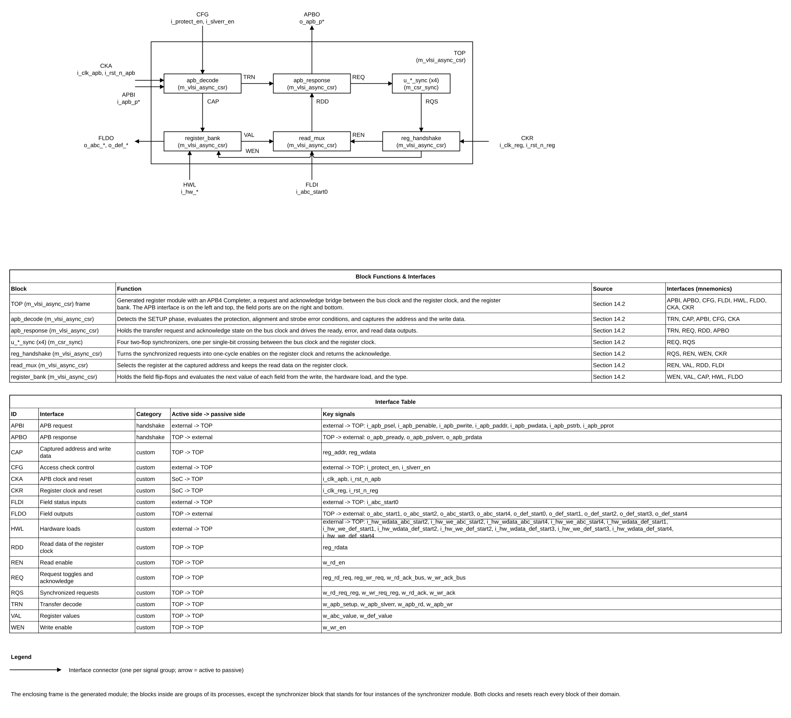

# APB CSR Generator Design Specification

> **Purpose:** Normative design contract for architecture, RTL, verification, DFT, and physical integration of this IP.
>
> This specification describes the design as it is (generator version 2.1, repository `https://github.com/nguyenquanicd/APB-CSR-Generator`): the behavior was read from `CSR_Generation.py` and measured by simulation of the generated RTL. Where a behavior is a limitation of the design rather than a wish, it is stated as such and recorded in section 20.
>
> Requirement terms: **shall** = mandatory and testable; **should** = recommended; **may** = optional. Every mandatory requirement has a stable REQ-<AREA>-<NNN> identifier and a verification method.

## Document map

1. [Purpose, scope, and product context](#1-purpose-scope-and-product-context)
2. [Normative references and precedence](#2-normative-references-and-precedence)
3. [Requirements and traceability](#3-requirements-and-traceability)
4. [Features and configurations](#4-features-and-configurations)
5. [Architecture](#5-architecture)
6. [External interfaces and ports](#6-external-interfaces-and-ports)
7. [Clock, reset, and power](#7-clock-reset-and-power)
8. [Parameters and elaboration configurations](#8-parameters-and-elaboration-configurations)
9. [Data representation and arithmetic](#9-data-representation-and-arithmetic)
10. [Detailed functional behavior](#10-detailed-functional-behavior)
11. [Register and programming model (CSR from workbook)](#11-register-and-programming-model)
12. [Error handling and recovery](#12-error-handling-and-recovery)
13. [Performance, power, and area](#13-performance-power-and-area)
14. [RTL implementation contract](#14-rtl-implementation-contract)
15. [Verification specification](#15-verification-specification)
16. [DFT and testability](#16-dft-and-testability)
17. [Physical design and timing integration](#17-physical-design-and-timing-integration)
18. [Security, safety, and reliability](#18-security-safety-and-reliability)
19. [Requirement-to-verification traceability](#19-requirement-to-verification-traceability)
20. [Assumptions, dependencies, and decisions](#20-assumptions-dependencies-and-decisions)
21. [Glossary](#21-glossary)
22. [References used to shape this template](#22-references-used-to-shape-this-template)

## 1. Purpose, scope, and product context

### 1.1 Purpose and scope

The APB CSR Generator removes the hand-written register block from an ASIC IP. A designer describes the control and status registers of the IP in a sheet of the VLSIT CSR workbook; the generator, a Python tool, turns that sheet into one synthesizable SystemVerilog module, an APB4 Completer (the register bank with its bus interface). The IP then controls its datapath through the output ports of the module (settings, start bits) and reports status and events through its input ports (state, error flags), while software reaches both sides over APB.

This document specifies two things: the tool (Section 10.2, tool operations TOOL-001 to TOOL-004) and the module that the tool generates (Sections 6 to 12). The module has no register map of its own; the map comes from the workbook, so Section 11 states the rules of the programming model and no table of registers.

**Included:** the command line and the workbook reader of `CSR_Generation.py`; the generated module in a one-clock configuration (CFG-SYNC) and in a two-clock configuration (CFG-ASYNC); the field types `rw`, `ro`, `rwi`, and `w1c`; the APB4 Completer behavior including error responses; the placeholder synchronizer model `m_csr_sync`; the files `filelist.f` and `Debug/debug.json`.

**Excluded:** validation of the workbook beyond what the reader needs (offsets, overlap, and names are checked by the scripts `vlsit_csr_tool.py` and `vlsit_csr_generate.py` of the VLSIT skills, not by the generator); protocols other than APB; byte-lane (sparse) writes; data widths other than 32 bits and address widths other than 16 bits; interrupt aggregation; the technology synchronizer cell (the integrator replaces `m_csr_sync`); the connection of the module to the rest of the IP.

### 1.2 Deployment assumptions

| Item | Specification |
|---|---|
| Target SoC / product class | Any ASIC or FPGA design that needs a memory-mapped control/status register bank on an APB4 bus (peripheral, bridge, accelerator control) |
| Technology / library assumptions | Synthesizable RTL; no library cell inside the module; the synchronizer model `m_csr_sync` is replaced by a wrapper of the technology synchronizer cell before tape-out (DEP-004) |
| Operating modes and workload | One APB Requester; one transfer in flight; register access only (no data streaming) |
| Security / privilege context | Optional check of `PPROT[1]` (non-secure access) only; no other privilege or secure-state logic |
| External dependencies | APB Requester or bridge; a reset controller that releases each reset synchronously to its clock; Python 3 with `openpyxl` for the tool; the design that connects the field ports |

### 1.3 Feature summary

| Feature ID | Feature | Required / optional | Configuration condition | Requirements |
|---|---|---|---|---|
| FEAT-001 | Generation of the CSR module from a workbook sheet | Required | Always present | REQ-GEN-001 to REQ-GEN-010 |
| FEAT-002 | APB4 Completer with PREADY wait state and PSLVERR | Required | Always present | REQ-IF-001, REQ-FUNC-001, REQ-FUNC-008 |
| FEAT-003 | Field types rw, ro, rwi, w1c at bit-field granularity | Required | Always present | REQ-IF-003, REQ-FUNC-002 to REQ-FUNC-007 |
| FEAT-004 | Access checks: protection, word alignment, full-strobe write | Optional | Runtime enable inputs `i_protect_en`, `i_slverr_en` | REQ-ERR-001 to REQ-ERR-005 |
| FEAT-005 | Separate register clock with a request/acknowledge handshake | Optional | CFG-ASYNC (workbook cell Asynchronous = 1) | REQ-CLK-002, REQ-FUNC-009 |
| FEAT-006 | Debug dump of the parsed workbook | Required | Always present | REQ-GEN-008 |

## 2. Normative references and precedence

### 2.1 Normative references

| Ref ID | Document and revision | Applicable clauses | Authority / notes |
|---|---|---|---|
| REF-001 | Arm IHI 0024D (ID041221), AMBA APB Protocol Specification, APB2 to APB5, converted file `vlsit_apb_amba_apb_ihi0024d.md` of the specification skill | 2.1 signals, 3.1 write transfers, 3.2 write strobes, 3.3 read transfers, 3.4 error response, 3.5 protection | Protocol authority; the module is an APB4 Completer |
| REF-002 | APB-CSR-Generator version 2.1: `CSR_Generation.py`, `README.md`, `RTL/` and `sim/tests/` of the repository (commit that follows `05e72f3`) | Whole repository | Product behavior: the design as built; behavior is also confirmed by the simulations of Section 15 |
| REF-003 | VLSIT RTL Design Rules v2, VLSIT_RTL_Design_Rule.md (`spec_template/` of `VLSIT_RTL_Generator_AI_Model`) | All applicable rules | Mandatory RTL coding, hierarchy, reset, CDC, and naming baseline |
| REF-004 | IEEE 1800-2017 SystemVerilog | Synthesizable subset | Subject to REF-003 and selected frontend support |
| REF-005 | VLSIT CSR Specification Template workbook, VLSIT_CSR_Specification_Template.xlsx (`spec_template/`) | Sheets `CSR` and `ASYNC_CSR`: configuration table and register definition table | Authority for the input format of the generator (columns, field types); this IP has no register map of its own (DEC-001) |

### 2.2 Source-of-truth and conflict handling

1. The selected external protocol revision (REF-001) defines protocol behavior for the declared interface profile.
2. The design as built (REF-002) defines product-specific behavior; where it differs from REF-001 on a recommendation, the difference is declared in Section 2.3.
3. This specification defines the IP contract and shall remain consistent with REF-001, REF-002, and the VLSIT RTL Design Rules v2.
4. REF-003 is the mandatory RTL coding, hierarchy, reset, CDC, and naming baseline. The generated RTL complies with it (REQ-RTL-001); do not create a local RTL exception.
5. REF-005 defines the workbook format. The registers of a design that uses this generator are declared only in that design's workbook, never in a specification of the design.
6. The protocol is AMBA APB, revision IHI 0024D, role Completer, with the optional signals PSTRB, PPROT, and PSLVERR; PWAKEUP, the user signals, and the parity (check) signals are not present.
7. Resolve conflicts through an explicit product decision; do not guess or weaken a requirement.

**Naming rule:** the default naming rule of the skill vlsit-rtl-generator, VLSIT_RTL_Design_Rule.md v2, section 2, path `VLSIT_RTL_Generator_AI_Model/spec_template/VLSIT_RTL_Design_Rule.md` (copy `reference/templates/VLSIT_RTL_Design_Rule.md` of the specification skill), version v2 (rule R-026), chosen by the user on 2026-10-28.

### 2.3 Compliance declaration

| Standard | Revision / profile | Role implemented | Options | Deviations |
|---|---|---|---|---|
| AMBA APB | IHI 0024D, APB4 profile | Completer | PSTRB, PPROT, PSLVERR present; 32-bit data, 16-bit address; PWAKEUP, PAUSER, PWUSER, PRUSER, PBUSER, and check signals absent | DEV-001: after an error response, PSLVERR stays HIGH until the next SETUP phase, although REF-001 section 3.4 recommends LOW when PSEL, PENABLE, or PREADY is LOW (a recommendation, not a requirement). DEV-002: sparse writes are rejected; REF-001 section 3.2.1 allows a Completer that supports a limited set of access types if the limit is documented, which Section 6.3 does. DEV-003: with `i_slverr_en` = 0, PSLVERR keeps its last value (ERR-004 of Section 12). |

## 3. Requirements and traceability

Areas: GEN (the tool), IF (interfaces), FUNC (function), CLK, RESET, ERR, PARAM, PERF, RTL, VER, SEC. "CFG-SYNC" and "CFG-ASYNC" are the configurations of Section 4.

| ID | Requirement using shall/should/may | Source | Applies to | Verification method |
|---|---|---|---|---|
| REQ-GEN-001 | The tool shall be run as `CSR_Generation.py WORKBOOK SHEET` with the optional switches `--out DIR` (default: the current folder), `--project NAME`, and `--author "NAME (user)"`, and shall exit with status 1 when the workbook or the sheet cannot be opened (the Python error is printed) or when a required configuration value is missing (the message names the value). | REF-002 CSR_Generation.py main | All configurations | Test TEST-001 |
| REQ-GEN-002 | The tool shall read the configuration table below the row that contains `Table - Configuration` by matching the first-column text on `Module Name`, `Protocol`, `Data Width`, `Address Width`, `Asynchronous`, and shall start the register table at the first row whose first column contains `REGISTER`. | REF-002 read_workbook | All configurations | Test TEST-001 |
| REQ-GEN-003 | The tool shall treat a row with text in column A as a new register (name in A, offset in B, reset in F, description in G) and every other row as a field of the last register (bit name in C, bit range in D, type in E, reset in F, description in G), and shall skip a row whose bit name and bit range are both empty. | REF-002 read_workbook | All configurations | Test TEST-001 |
| REQ-GEN-004 | The tool shall accept only the protocol `APB` and shall exit with status 1 and a message for any other protocol. | REF-002 sfr.__init__ | All configurations | Test TEST-001 |
| REQ-GEN-005 | The tool shall write `RTL/{Module Name}.sv`, `RTL/filelist.f` (paths relative to the folder of the file), and `Debug/debug.json` under the folder of `--out`, and shall create the folders when they are absent. | REF-002 main | All configurations | Test TEST-001 |
| REQ-GEN-006 | When `Asynchronous` is 1 the tool shall write `RTL/models/m_csr_sync.sv` only if the file does not exist, and when `Asynchronous` is 0 it shall write no synchronizer model. | REF-002 main | CFG-ASYNC, CFG-SYNC | Test TEST-001 |
| REQ-GEN-007 | The tool shall start every generated `.sv` file with the six header fields Project, Author, AI Flow, AI Flow Page, Date, and Description, where Project and Author come from `--project` and `--author` (defaults: `APB-CSR-Generator` and the login name followed by ` (user)`) and the Description states that the RTL follows the VLSIT RTL Design Rule v2. | REF-003 FIL-01 | All configurations | Rule check TEST-009 |
| REQ-GEN-008 | `Debug/debug.json` shall contain the module name, the widths, the Asynchronous value, the generator version, and, for every register and field, name, offset, bit range, type, reset value, and description exactly as read from the workbook. | REF-002 sfr.gen_json | All configurations | Test TEST-001 |
| REQ-GEN-009 | For the same workbook, sheet, and switches the generated files shall be identical except for the Date field of the header. | REF-002 | All configurations | Test TEST-002 |
| REQ-GEN-010 | The generated module and `m_csr_sync` shall pass `vlsit_rtl_check.py check` without an ERROR and shall pass verilator and slang lint without an error. | REF-003 | All configurations | Rule check and lint TEST-009 |
| REQ-IF-001 | The generated module shall be an APB4 Completer with the ports PSEL, PENABLE, PWRITE, PADDR (16 bits), PWDATA (32 bits), PSTRB (4 bits), PPROT (3 bits) as inputs and PREADY, PRDATA (32 bits), PSLVERR as outputs, named with the tag `apb` per REF-003 PRT-01, and shall have no other APB signal. | REF-001 §2.1; REF-003 PRT-01 | All configurations | Lint, port check TEST-009 |
| REQ-IF-002 | The generated module shall have the clock `i_clk_apb` and the active-low reset `i_rst_n_apb`; in CFG-ASYNC it shall also have `i_clk_reg` and `i_rst_n_reg`. | REF-003 PRT-02 | All configurations | Lint, port check TEST-009 |
| REQ-IF-003 | For every field that is not named `reserved` the module shall have these ports: type `ro`: input `i_{reg}_{field}`; type `rw`: output `o_{reg}_{field}`; types `rwi` and `w1c`: output `o_{reg}_{field}`, input `i_hw_wdata_{reg}_{field}` of the same width, and one-bit input `i_hw_we_{reg}_{field}`; a field named `reserved` shall have no port. | REF-002 register.gen_port_logic | All configurations | Test TEST-001, simulation TEST-004 |
| REQ-IF-004 | Every output of the module shall be a flip-flop output, so no combinational path leads from an input to an output. | REF-002 | All configurations | Inspection, rule check TEST-009 |
| REQ-IF-005 | The module shall take `i_protect_en` and `i_slverr_en` as static inputs that are constant after reset. | REF-002; ERR-004 | All configurations | Inspection; integration check |
| REQ-FUNC-001 | A transfer shall start in the SETUP phase, that is in a cycle with PSEL = 1 and PENABLE = 0; in a SETUP phase without error the module shall capture PADDR, and for a write also PWDATA, into holding flip-flops. | REF-001 §3.1, §3.3 | All configurations | Simulation TEST-004 |
| REQ-FUNC-002 | A write without error shall change a field only as its type says: `rw` loads the PWDATA bits of the field; `rwi` loads the same bits; `w1c` clears every bit for which the PWDATA bit is 1 and keeps the others, unless a hardware load of the field takes priority in the same cycle (REQ-FUNC-003); `ro` and `reserved` ignore the write. | REF-002 bit.next_value_cal | All configurations | Simulation TEST-004 |
| REQ-FUNC-003 | In one cycle of the register clock the next value of a field with a hardware load port (`i_hw_we_{reg}_{field}`) shall be chosen in this order. Type `rwi`: a software write to the register, then the hardware load, then hold. Type `w1c`: the hardware load, then a software clear (a PWDATA bit of 1 clears the bit), then hold. A hardware load shall load the full value of `i_hw_wdata_{reg}_{field}`. A hardware load to a `w1c` field therefore always takes effect, also in the cycle of a software write to its register. | REF-002 bit.next_value_cal; DEC-006 | All configurations | Simulation TEST-005 |
| REQ-FUNC-004 | A read without error shall return, in PRDATA, the value of the register at the captured address, built from the flip-flop value of each `rw`, `rwi`, `w1c` field and the input value of each `ro` field, sampled in the cycle of the read enable of the register clock domain, with every `reserved` bit and every bit that no field covers returning 0. | REF-002 register.gen_rtl | All configurations | Simulation TEST-004 |
| REQ-FUNC-005 | A read of an aligned address that is not a register offset shall return 0 and complete without error; a write to such an address shall change nothing and complete without error. | REF-002 prdata_rtl | All configurations | Simulation TEST-006 |
| REQ-FUNC-006 | After reset every `rw`, `rwi`, and `w1c` field shall hold the reset value of the workbook for that field, and the `reserved` and `ro` fields have no storage. | REF-002 register.gen_rtl | All configurations | Simulation TEST-003 |
| REQ-FUNC-007 | An `ro` field shall be a direct pass-through of its input to the read value, with no flip-flop in the module other than the read data register. | REF-002 register.gen_rtl | All configurations | Inspection, simulation TEST-004 |
| REQ-FUNC-008 | In CFG-SYNC a transfer without error shall complete with PREADY = 1 in the second ACCESS cycle, that is with exactly one wait state, and a write shall be visible on the field output in the cycle in which PREADY is 1. | REF-001 §3.1.2; REF-002 | CFG-SYNC | Simulation TEST-004 |
| REQ-FUNC-009 | In CFG-ASYNC a transfer without error shall complete when the acknowledge of the register clock domain has been synchronized back, with PREADY = 1 for one cycle; the register update of a write shall happen before PREADY; PRDATA shall be valid in the cycle in which PREADY is 1; the number of wait states shall not be promised. | REF-002 | CFG-ASYNC | Simulation TEST-007 |
| REQ-FUNC-010 | PRDATA shall hold the read data of the last read without error and shall not change in a cycle in which PREADY = 1 for a write or for an error. | REF-001 §3.4; REF-002 | All configurations | Simulation TEST-004 |
| REQ-ERR-001 | When `i_slverr_en` = 1 the module shall give an error response to a SETUP phase in which any of these holds: `i_protect_en` = 1 and PPROT[1] = 1; PADDR[1:0] is not 00; the transfer is a write and PSTRB is not 4'b1111. | REF-002 apb_access; REF-001 §3.2.1, §3.4, §3.5 | All configurations | Simulation TEST-008 |
| REQ-ERR-002 | A transfer with an error response shall change no field, shall not capture address or data, and shall not update PRDATA. | REF-002 apb_access | All configurations | Simulation TEST-008 |
| REQ-ERR-003 | An error response shall have PREADY = 1 and PSLVERR = 1 in the first ACCESS cycle (no wait state), and PSLVERR shall stay 1 until the next SETUP phase while `i_slverr_en` = 1. | REF-002; DEV-001 | All configurations | Simulation TEST-008 |
| REQ-ERR-004 | When `i_slverr_en` = 0 the module shall generate no error response: PSTRB shall be ignored and a write shall store the whole word, and PSLVERR shall keep the value that it had before; the integrator shall therefore hold `i_slverr_en` constant after reset. | REF-002; DEV-003 | All configurations | Simulation TEST-008 |
| REQ-ERR-005 | When `i_protect_en` = 0 the module shall not check PPROT; PPROT bits other than bit 1 shall never cause an error. | REF-002 apb_access; REF-001 §3.5 | All configurations | Simulation TEST-008 |
| REQ-RESET-001 | An asserted `i_rst_n_apb` (and `i_rst_n_reg` in CFG-ASYNC) shall asynchronously clear every flip-flop of its domain: fields to their workbook reset values, and the address and data holding flip-flops, PREADY, PSLVERR, and PRDATA to 0. | REF-002; REF-003 RST-01 | All configurations | Simulation TEST-003 |
| REQ-RESET-002 | A reset asserted in the middle of a transfer shall abandon the transfer: PREADY and PSLVERR are 0 while the reset is asserted and no write takes effect after the reset. | REF-002 | All configurations | Simulation TEST-003 |
| REQ-RESET-003 | The reset inputs shall be released synchronously to the clock of their domain by the integrator; the module contains no reset synchronizer. | REF-003 RST-02; DEP-003 | All configurations | Integration review |
| REQ-CLK-001 | In CFG-SYNC every flip-flop shall be clocked by `i_clk_apb` on its rising edge. | REF-002 | CFG-SYNC | Inspection, lint |
| REQ-CLK-002 | In CFG-ASYNC the field flip-flops and the read data snapshot shall be clocked by `i_clk_reg`, the APB capture, request, acknowledge, PREADY, PSLVERR, and PRDATA flip-flops by `i_clk_apb`, and the four single-bit crossings (read request, write request, read acknowledge, write acknowledge) shall each pass through a `m_csr_sync` instance with `PARA_LEVELS` = `LPARA_SYNC_STAGES` (2). | REF-002; REF-003 CLK-01, CLK-02 | CFG-ASYNC | Inspection, CDC analysis TEST-011 |
| REQ-CLK-003 | In CFG-ASYNC the address and write-data holding registers (clock `i_clk_apb`) and the read data snapshot (clock `i_clk_reg`) shall change only before the request or acknowledge that qualifies them can be seen in the other domain, so that the destination samples a stable value. | REF-002 | CFG-ASYNC | CDC analysis TEST-011 |
| REQ-PARAM-001 | The module shall have no overridable parameter; the widths and the register offsets shall be the localparams `LPARA_ADDR_W` (16), `LPARA_DATA_W` (32), `LPARA_STRB_W` (4), `LPARA_{REG}_OFFSET`, and, in CFG-ASYNC, `LPARA_SYNC_STAGES` (2), fixed by regenerating the module. | REF-002; REF-003 PAR-01 | All configurations | Inspection |
| REQ-PERF-001 | In CFG-SYNC a transfer without error shall take three cycles from SETUP to the cycle in which PREADY = 1, and an error response shall take two cycles. | REF-002 | CFG-SYNC | Simulation TEST-004, TEST-008 |
| REQ-PERF-002 | The module shall accept one transfer at a time; a new SETUP phase shall be started only after the cycle in which PREADY = 1. | REF-001 §3 | All configurations | Protocol checker |
| REQ-RTL-001 | The generated files shall follow REF-003: names, `input wire`/`output logic` ports in aligned groups, header, process labels, case defaults without don't-care values, no latch, no unused declaration. | REF-003 | All configurations | Rule check TEST-009 |
| REQ-RTL-002 | The model `m_csr_sync` shall keep its module name and port names (`i_clk_dst`, `i_rst_n_dst`, `i_d`, `o_q`, parameter `PARA_LEVELS`), so that a wrapper of the technology synchronizer cell can replace it without changing the generated module. | REF-002; REF-003 CLK-02 | CFG-ASYNC | Inspection |
| REQ-VER-001 | The behavior and timing of generator version 2.1 shall equal those of version 1.2 in cycle-by-cycle comparison under random APB traffic with errors and resets, except in a cycle in which a hardware load and a software clear meet on a `w1c` field (DEC-006). | REF-002 README revisions 2.0 and 2.1; DEC-006 | All configurations | Equivalence run TEST-010 |
| REQ-SEC-001 | The module shall treat PPROT[1] = 1 as a non-secure access only when `i_protect_en` = 1 and `i_slverr_en` = 1, and shall implement no other access-control function. | REF-001 §3.5; REF-002 | All configurations | Simulation TEST-008 |

## 4. Features and configurations

| Configuration ID | Enabled features | Disabled features | Interfaces / widths | Intended use | Verification target |
|---|---|---|---|---|---|
| CFG-SYNC | Workbook cell Asynchronous = 0 (sheet `CSR`): one clock for APB and registers; FEAT-001 to FEAT-004, FEAT-006 | FEAT-005 (no register clock, no synchronizer) | APB4 Completer 16-bit address, 32-bit data; one port set per field | Register clock equal to the APB clock | Simulation, lint, rule check, equivalence |
| CFG-ASYNC | Asynchronous = 1 (sheet `ASYNC_CSR`): FEAT-001 to FEAT-006 | None | As CFG-SYNC plus `i_clk_reg` and `i_rst_n_reg` | Registers in the clock domain of the IP, APB in the bus clock domain | Simulation with several clock ratios, lint, rule check, CDC analysis |

The reference workbook for the figures and tests is the VLSIT CSR Specification Template (sheets `CSR` and `ASYNC_CSR`, two registers named `abc` and `def` with one field of each type); its names appear in the waveforms only. The set of field ports is not fixed by this specification: it follows the workbook that the integrator supplies (DEC-002). An optional feature is absent when its configuration is not selected; there is no tied-off or runtime-disabled form except the access checks, which are present and runtime-disabled by `i_protect_en` and `i_slverr_en`. A sheet whose Asynchronous cell does not match its sheet name is accepted by the generator; the integrator shall use sheet `CSR` for 0 and `ASYNC_CSR` for 1 (the VLSIT skill scripts check this).

## 5. Architecture

### 5.1 Overview and block responsibilities

The generator reads one sheet, builds an in-memory model of registers and fields (classes `register`, `bit`), and emits the module from templates (classes `apb_protocol`, `sfr`). The generated module has an APB side and a register side. In CFG-SYNC they are the same clock domain; in CFG-ASYNC they are separate and are joined by a request/acknowledge handshake with two-flop synchronizers.

| Block | Responsibility | Inputs / outputs | Clock/reset domain | State or storage |
|---|---|---|---|---|
| Workbook reader (tool) | Parse configuration and register rows of the sheet | Workbook, sheet name / in-memory model | Not applicable (software) | None |
| RTL emitter (tool) | Write module, file list, synchronizer model, and debug dump | Model / files | Not applicable (software) | None |
| APB decode and check | Detect SETUP, evaluate the error conditions, capture address and write data, hold PSLVERR | APB inputs, `i_protect_en`, `i_slverr_en` / error flag, read and write enables | `i_clk_apb` / `i_rst_n_apb` | Address, write data, PSLVERR flip-flops |
| Request/acknowledge bridge (CFG-ASYNC only) | Carry the read and write enables to the register clock and the acknowledge back | Enables, acknowledges / synchronized pulses | Both clocks | Request and delayed-acknowledge flip-flops |
| Register bank | Hold the fields, evaluate the next value of each field, expose the field ports | Write enable, write data, field inputs / field outputs | `i_clk_apb` (CFG-SYNC) or `i_clk_reg` (CFG-ASYNC) | One flip-flop per `rw`, `rwi`, `w1c` field bit |
| Read mux and read data register | Select the register at the captured address and register the value | Register values, captured address / PRDATA | Register clock, then APB clock in CFG-ASYNC | Read data register (and one APB-clock copy in CFG-ASYNC) |
| PREADY generator | Produce PREADY one cycle after the enable, or after an error SETUP phase | Enables, error flag / PREADY | `i_clk_apb` | PREADY flip-flop |
| Synchronizer model `m_csr_sync` | Two-flop synchronizer of one bit (placeholder) | Bit and destination clock / synchronized bit | Destination clock | `PARA_LEVELS` flip-flops |

### 5.2 Block diagram

*Figure 5-1. Block diagram of the generated module, two-clock configuration (CFG-ASYNC); the one-clock module has no synchronizer block and no register-side handshake. Source: `figures/block_diagram.drawio` (draw.io, VLSIT library, drawn by `vlsit_spec_diagram.py`). The frame is the top module, the blocks are its instances, each connector is one interface with its mnemonic, and the two tables under the diagram in the source file describe the blocks and the interfaces.*

### 5.3 Transaction and dataflow

**Write (CFG-SYNC).** In the SETUP phase the module evaluates the error conditions. Without an error it captures the address and the data and, one cycle later, raises the write enable; the register at the captured address loads its fields at the end of that cycle; PREADY is raised one cycle after the enable. **Read** is the same up to the enable; the read data register then loads the value of the selected register; PRDATA is valid when PREADY is 1. **Error:** in the SETUP phase PSLVERR is loaded and PREADY is raised at once, the enables stay low, and nothing is captured.

**CFG-ASYNC.** The enable becomes a request that toggles in the APB domain, crosses through two flip-flops, becomes a one-cycle enable in the register domain (which updates the fields or the read data register), and is acknowledged back through two flip-flops; the falling edge of the synchronized acknowledge raises PREADY and, for a read, copies the read data to the APB clock domain.

### 5.4 Invariants

- At most one transfer is in flight; a request flip-flop is set only by a transfer without error and is cleared only by the matching acknowledge.
- A field flip-flop changes only through a write enable of its own register, a hardware load, or reset.
- `reserved` bits and unmapped addresses read as 0 and cannot be written.
- PREADY is a single-cycle pulse per transfer.
- PRDATA changes only in the cycle in which a read completes (or at reset).

## 6. External interfaces and ports

### 6.1 Interface inventory

| Interface ID | Type and revision | Role | Direction at IP boundary | Clock domain | Required / optional | Configurations |
|---|---|---|---|---|---|---|
| IF-001 | AMBA APB, IHI 0024D, APB4 profile | Completer | Requester to IP (control), IP to Requester (response) | CLK-APB | Required | All |
| IF-002 | Register field ports (custom, one set per field) | Provider of settings and consumer of status | IP internal logic to and from the module | CLK-REG (CLK-APB in CFG-SYNC) | Required when the workbook has a field of that type | All |
| IF-003 | Access check control (static levels) | Configuration | Integrator to module | CLK-APB (static) | Required | All |
| IF-004 | Clock and reset | Clock and reset inputs | Integrator to module | CLK-APB, CLK-REG | Required | All; the register pair only in CFG-ASYNC |

### 6.2 Complete port list

The ports of the APB interface, the clocks, the resets, and the access check control are fixed. The field ports follow the workbook (DEC-002): the table of field port patterns below the port list gives one set of ports per field as REQ-IF-003 says. The module has no test, interrupt, or sideband port.

| Port | Direction | Width | Meaning (function) | Clock domain | Signal type | Reset / idle value | Timing / sampling | Configurations |
|---|---|---:|---|---|---|---|---|---|
| i_clk_apb | Input | 1 | APB clock; clocks every flip-flop of the APB side (and of the register side in CFG-SYNC) | CLK-APB | clock | Not applicable | Rising edge | All |
| i_rst_n_apb | Input | 1 | Active-low reset of the APB side (and of the register side in CFG-SYNC) | CLK-APB | reset | Not applicable | Asynchronous assertion, release synchronous to i_clk_apb | All |
| i_clk_reg | Input | 1 | Register clock; clocks the field flip-flops and the read data register | CLK-REG | clock | Not applicable | Rising edge | CFG-ASYNC |
| i_rst_n_reg | Input | 1 | Active-low reset of the register side | CLK-REG | reset | Not applicable | Asynchronous assertion, release synchronous to i_clk_reg | CFG-ASYNC |
| i_apb_psel | Input | 1 | APB select of this Completer (PSELx) | CLK-APB | level (held through the transfer) | Requester drives 0 in reset | Sampled at the rising edge of i_clk_apb | All |
| i_apb_penable | Input | 1 | APB enable; 0 in the SETUP phase, 1 in the ACCESS phase | CLK-APB | level (held through the ACCESS phase) | Requester drives 0 in reset | Sampled at the rising edge | All |
| i_apb_pwrite | Input | 1 | Direction: 1 write, 0 read | CLK-APB | data (valid while i_apb_psel is 1) | Not significant | Sampled in the SETUP phase | All |
| i_apb_paddr | Input | 16 | Byte address of the register; bits [1:0] shall be 00 | CLK-APB | data (valid while i_apb_psel is 1) | Not significant | Sampled in the SETUP phase | All |
| i_apb_pwdata | Input | 32 | Write data | CLK-APB | data (valid while i_apb_psel and i_apb_pwrite are 1) | Not significant | Sampled in the SETUP phase | All |
| i_apb_pstrb | Input | 4 | Byte strobes of a write; all four shall be 1 | CLK-APB | data (valid while i_apb_psel and i_apb_pwrite are 1) | Not significant | Sampled in the SETUP phase | All |
| i_apb_pprot | Input | 3 | Protection type; only bit 1 (non-secure when 1) is used | CLK-APB | data (valid while i_apb_psel is 1) | Not significant | Sampled in the SETUP phase | All |
| o_apb_pready | Output | 1 | Transfer ready; ends the wait states | CLK-APB | level (high for one cycle per transfer) | 0 | Flip-flop output, changes after the rising edge | All |
| o_apb_pslverr | Output | 1 | Transfer error response | CLK-APB | level (valid while psel, penable, and pready are 1; held high until the next SETUP after an error) | 0 | Flip-flop output | All |
| o_apb_prdata | Output | 32 | Read data | CLK-APB | data (valid in the cycle in which o_apb_pready is 1 for a read) | 0 | Flip-flop output | All |
| i_protect_en | Input | 1 | 1 enables the non-secure access check on PPROT[1] | CLK-APB | static (constant after reset) | 0 or 1 | Sampled in the SETUP phase | All |
| i_slverr_en | Input | 1 | 1 enables the error conditions (protection, alignment, strobe) | CLK-APB | static (constant after reset) | 0 or 1 | Sampled in the SETUP phase | All |

**Field port patterns** (DEC-002): one set per field of the workbook; they are patterns, not port names.

| Pattern | Direction | Width | Meaning (function) | Clock domain | Signal type | Reset / idle value | Timing / sampling | Configurations |
|---|---|---:|---|---|---|---|---|---|
| `i_{reg}_{field}` | Input | field width | Status value of a field of type ro, read by software | CLK-REG (CLK-APB in CFG-SYNC) | data (sampled in the cycle of the read enable) | Not significant | Sampled at the rising edge of the register clock | All |
| `o_{reg}_{field}` | Output | field width | Setting or state of a field of type rw, rwi, or w1c, for the IP logic | CLK-REG (CLK-APB in CFG-SYNC) | level | Reset value of the field | Flip-flop output | All |
| `i_hw_wdata_{reg}_{field}` | Input | field width | Value that hardware loads into a field of type rwi or w1c | CLK-REG (CLK-APB in CFG-SYNC) | data (valid while the matching load enable is 1) | Not significant | Sampled at the rising edge of the register clock | All |
| `i_hw_we_{reg}_{field}` | Input | 1 | Load enable of the hardware value (one cycle loads once; held high loads in every cycle) | CLK-REG (CLK-APB in CFG-SYNC) | pulse (1 cycle minimum, loads once per cycle in which it is 1) | 0 | Sampled at the rising edge of the register clock | All |

### 6.3 Protocol behavior

The module is an APB4 Completer of REF-001 (revision IHI 0024D), without PWAKEUP, the user signals, and the parity signals (REF-001 §2.1). Transfers follow §3.1 and §3.3: the SETUP phase has PSEL = 1 and PENABLE = 0; the ACCESS phase has PENABLE = 1 and lasts until the Completer raises PREADY. The Requester shall hold the address, direction, and write data from the SETUP phase until the transfer completes (§3.1.1).

| Case | Legal behavior | Illegal / unsupported case | IP response | Requirement IDs |
|---|---|---|---|---|
| Write of a full word to a register offset | PSTRB = 4'b1111, PADDR[1:0] = 00 | Not applicable | Fields load per their type; one wait state in CFG-SYNC; completes with PSLVERR = 0 | REQ-FUNC-002, REQ-FUNC-008 |
| Read of a register offset | PWRITE = 0, PADDR[1:0] = 00 | Not applicable | Returns the register value; one wait state in CFG-SYNC | REQ-FUNC-004, REQ-FUNC-008 |
| Write with a partial strobe (REF-001 §3.2) | Not supported (sparse writes) | PSTRB not 4'b1111 on a write | With `i_slverr_en` = 1: error response, no change. With 0: whole word stored | REQ-ERR-001, REQ-ERR-004 |
| Read with PSTRB not 0 (REF-001 §3.2: Requester drives PSTRB LOW on a read) | PSTRB = 0 | Requester error | PSTRB is not checked on a read | REQ-ERR-001 |
| Unaligned PADDR (REF-001 §2.1.1: result UNPREDICTABLE) | PADDR[1:0] = 00 | PADDR[1:0] not 00 | With `i_slverr_en` = 1: error response. With 0: matches no register (read 0, write ignored) | REQ-ERR-001, REQ-ERR-004 |
| Aligned address that is not a register | Any 4-byte aligned address | Not applicable | Read 0, write ignored, PSLVERR = 0 | REQ-FUNC-005 |
| Non-secure access (REF-001 §3.5, PPROT[1]) | PPROT[1] = 0 or `i_protect_en` = 0 | PPROT[1] = 1 with `i_protect_en` = 1 | Error response (when `i_slverr_en` = 1), no change | REQ-ERR-001, REQ-SEC-001 |
| Error response (REF-001 §3.4) | PSLVERR valid when PSEL, PENABLE, PREADY are 1 | Not applicable | PREADY and PSLVERR in the first ACCESS cycle; PSLVERR then stays 1 until the next SETUP (DEV-001) | REQ-ERR-003 |
| New SETUP before PREADY | Not allowed by REF-001 | Requester violates the protocol | Not detected; behavior unspecified | REQ-PERF-002 |

### 6.4 Interrupts and events

**N/A:** the module has no interrupt or event output; sticky events are `w1c` fields that the IP logic sets through the hardware load ports and that software reads and clears, and the integrator forms any interrupt from the field outputs.

## 7. Clock, reset, and power

### 7.1 Clock domains

| Domain | Clock port | Edge | Frequency range | Source | Relationship to other clocks | Gating policy |
|---|---|---|---|---|---|---|
| CLK-APB | i_clk_apb | Rising | Not defined by the generator (TBD-001) | APB bus clock of the SoC | Asynchronous to CLK-REG in CFG-ASYNC | No gating inside the module; any gating is outside |
| CLK-REG | i_clk_reg | Rising | Not defined by the generator (TBD-001); any ratio to CLK-APB works functionally | Clock of the IP that owns the registers | Asynchronous to CLK-APB; in CFG-SYNC the same clock as CLK-APB (no separate port) | No gating inside the module |

### 7.2 CDC and RDC

All crossings exist only in CFG-ASYNC. The single-bit crossings use the toggle-level handshake of `apb_protocol`: a request is set by a transfer without error and held until its acknowledge returns, so each crossing is a level that changes at most once per transfer and is stable for many cycles. The synchronizer is `m_csr_sync` (two flip-flops, placeholder model) instantiated in the generated module; the integrator replaces it with the technology cell wrapper (DEP-004).

| Crossing ID | From → to | Signals | Structure | Reset handling | Constraints / verification |
|---|---|---|---|---|---|
| CDC-001 | CLK-APB → CLK-REG | Read request (flip-flop output of the APB side) | `m_csr_sync`, 2 stages, instance `u_rd_req_sync`, then edge detect | Both resets clear the request and the delay flip-flops | `set_clock_groups -asynchronous`; CDC tool; simulation with several clock ratios (TEST-007) |
| CDC-002 | CLK-APB → CLK-REG | Write request | `m_csr_sync`, 2 stages, instance `u_wr_req_sync` | As CDC-001 | As CDC-001 |
| CDC-003 | CLK-REG → CLK-APB | Read acknowledge (the delayed read request of the register side) | `m_csr_sync`, 2 stages, instance `u_rd_ack_sync`, then falling-edge detect | As CDC-001 | As CDC-001 |
| CDC-004 | CLK-REG → CLK-APB | Write acknowledge | `m_csr_sync`, 2 stages, instance `u_wr_ack_sync` | As CDC-001 | As CDC-001 |
| CDC-005 | CLK-APB → CLK-REG | Address and write data holding registers (bundled data, quasi-static) | No synchronizer; qualified by CDC-001 or CDC-002 | Holding registers cleared by `i_rst_n_apb` | Stable for at least the synchronizer latency before the enable; bound by TBD-003 |
| CDC-006 | CLK-REG → CLK-APB | Read data snapshot (bundled data, quasi-static) | No synchronizer; sampled by the falling edge of the synchronized read acknowledge (CDC-003) | Snapshot cleared by `i_rst_n_reg` | Stable before the sampling pulse; bound by TBD-003 |

Reset-domain crossing: a reset asserted in one domain only leaves the other domain's request and acknowledge flip-flops in their old state; the integrator shall assert both resets together (DEP-003, ASM-004).

### 7.3 Reset domains and sequencing

| Reset ID | Port | Polarity / assertion | Sync or async | Scope | Deassertion | Reset value |
|---|---|---|---|---|---|---|
| RST-APB | i_rst_n_apb | Active-low | Asynchronous assertion; release shall be synchronous to i_clk_apb | APB side (and the register side in CFG-SYNC) | Synchronous release by the integrator | Address, data, PSLVERR, PREADY, PRDATA, requests: 0; fields: workbook reset values (CFG-SYNC) |
| RST-REG | i_rst_n_reg | Active-low | Asynchronous assertion; release shall be synchronous to i_clk_reg | Register side (CFG-ASYNC) | Synchronous release by the integrator | Fields: workbook reset values; read data snapshot and register-side delay flip-flops: 0 |

There is one reset source per domain; there is no software reset and no warm or partial reset. While a reset is asserted PREADY and PSLVERR are 0. A stopped clock freezes the module; after reset release the module is idle and accepts the next SETUP phase.

### 7.4 Power intent (if applicable)

**N/A:** the module has no power domain, isolation, or retention; it is part of the power domain of the IP that instantiates it.

## 8. Parameters and elaboration configurations

The generated module has no overridable parameter (REQ-PARAM-001): the generator bakes every width, offset, and the synchronizer depth into the module as a localparam, so the configuration is changed by editing the workbook and generating again. There is therefore no `PARA_` parameter in the module; the only parameter of the delivered files is `PARA_LEVELS` of the placeholder model `m_csr_sync`.

| Parameter | Purpose | Default | Legal values / range | Dependencies / invalid combinations | Effect |
|---|---|---|---|---|---|
| PARA_LEVELS (`m_csr_sync`) | Number of flip-flops of the synchronizer model | 2 | 2 or more | The generated module instantiates it with `LPARA_SYNC_STAGES` = 2; a wrapper of the technology cell keeps the name | Latency of each crossing in destination-clock cycles |
| LPARA_ADDR_W | Width of the address port | 16 | 16 (fixed by the template workbook; the generator does not check it) | Equals the Address Width cell | Width of `i_apb_paddr` and of the captured address |
| LPARA_DATA_W | Width of the data ports | 32 | 32 | Equals the Data Width cell | Width of PWDATA, PRDATA, and the register value |
| LPARA_STRB_W | Number of byte strobes | 4 | LPARA_DATA_W / 8 | Derived | Width of `i_apb_pstrb` |
| LPARA_SYNC_STAGES | Stages of every synchronizer instance (CFG-ASYNC only) | 2 | 2 | Passed as `PARA_LEVELS` | Latency of the handshake |
| LPARA_{REG}_OFFSET | Byte offset of a register | From the workbook | 4-byte aligned, below 0x10000 | Unique per register (checked by the VLSIT scripts, not by the generator) | Address decode |

| Configuration | Parameter overrides | Features/interfaces | Expected hierarchy | Elaboration/lint/synthesis target |
|---|---|---|---|---|
| CFG-SYNC | None | One clock; APB side only plus field ports | One module (the generated module) | verilator and slang lint, rule check, simulation; reference sheet `CSR` |
| CFG-ASYNC | None | Two clocks; handshake bridge | The generated module with four instances of `m_csr_sync` (`u_rd_ack_sync`, `u_wr_ack_sync`, `u_rd_req_sync`, `u_wr_req_sync`) | verilator and slang lint, rule check, simulation with several clock ratios, CDC analysis; reference sheet `ASYNC_CSR` |

Illegal configurations are not detected by the generator: an offset that is not aligned or not unique, two overlapping fields, a field type other than `rw`, `ro`, `rwi`, `w1c`, an offset or reset value not written as `0x...` text, a width other than 32 and 16, and a `reserved` field of a type other than `ro` give undefined RTL (a `reserved` field of another type gets ports; a type outside the four makes the generated flip-flop process refer to undeclared signals, which lint reports). The VLSIT skill scripts `vlsit_csr_tool.py validate` and `vlsit_csr_generate.py` reject these cases before the generator runs (DEC-003, DEP-002).

## 9. Data representation and arithmetic

Bit 0 is the least significant bit. A register is a 32-bit word at a 4-byte aligned byte offset; PWDATA[31:0] and PRDATA[31:0] map to bits 31 to 0 of the register. The fields of a register are given in the workbook as `[hi:lo]` ranges; a field port is `hi-lo+1` bits wide (one bit has no range). There is no endianness, extension, or arithmetic in the module except the bit-wise clear of `w1c`.

| Quantity | Width | Encoding / range | Extension / truncation | Overflow / invalid behavior |
|---|---:|---|---|---|
| Register offset | 16 | Byte address, multiple of 4, below 0x10000 | None | An address that is not an offset reads 0 and ignores a write (REQ-FUNC-005) |
| Register value | 32 | Concatenation of the field values | A bit covered by no field reads 0 | None |
| Field of type rw / rwi | 1 to 32 | Binary value as written | None | None |
| Field of type w1c | 1 to 32 | Binary value; a software write of 1 clears the bit | None | A hardware load replaces the whole value and wins over a same-cycle software clear |
| Field of type ro | 1 to 32 | Binary value of the input at the read enable | None | None |
| Field named `reserved` | 1 to 31 | Reads 0 | None | A write is ignored |
| Reset value of a field | Field width | Hexadecimal text `0x...` of the workbook | The reset text is written as a sized hexadecimal literal of the field width | A value that does not fit gives a lint width warning (checked by the VLSIT scripts) |
| PSTRB | 4 | 4'b1111 for every write | Bit n qualifies PWDATA[8n+7:8n] | Any other value on a write is a sparse write: rejected (REQ-ERR-001) |
| PPROT | 3 | Bit 1 = 1 non-secure; bits 0 and 2 unused | None | None |

## 10. Detailed functional behavior

### 10.1 Modes and state transitions

The module has no FSM and no enumerated state. A transfer passes through phases that are visible on the ports; the table names them for the cycle descriptions.

| Mode/state | Entry condition | Behavior | Exit condition | Outputs / side effects |
|---|---|---|---|---|
| Idle | Reset released, or the cycle after PREADY | PSEL = 0 or no transfer; all enables low | PSEL = 1 with PENABLE = 0 | PREADY = 0 |
| SETUP | PSEL = 1 and PENABLE = 0 | Error conditions evaluated; address and data captured if there is no error | Next cycle | PREADY rises next cycle if there is an error; else the enable rises next cycle |
| ACCESS (waiting) | PENABLE = 1, PREADY = 0 | Enable active (sync) or handshake running (async); fields update or the read data register loads | PREADY = 1 | PREADY = 0 |
| Complete | PREADY = 1 with PSEL and PENABLE | One cycle; the Requester samples PRDATA and PSLVERR | Next cycle | PREADY = 1 for one cycle |

### 10.2 Operations

| Operation ID | Inputs / preconditions | Processing semantics | Result / completion | Latency / ordering |
|---|---|---|---|---|
| OP-001 | Write transfer, full strobe, aligned address, no error condition | Field next values by type (REQ-FUNC-002, REQ-FUNC-003) | PREADY = 1, PSLVERR = 0 | CFG-SYNC: 3 cycles from SETUP; CFG-ASYNC: depends on the clocks; one transfer at a time |
| OP-002 | Read transfer, aligned address, no error condition | Select the register at the address (0 if none); load the read data register | PREADY = 1, PRDATA valid, PSLVERR = 0 | As OP-001 |
| OP-003 | Transfer with an error condition and `i_slverr_en` = 1 | No capture, no register change, no PRDATA update | PREADY = 1 in the first ACCESS cycle, PSLVERR = 1 until the next SETUP | 2 cycles from SETUP (both configurations) |
| OP-004 | `i_rst_n_apb` or `i_rst_n_reg` asserted | Clear flip-flops of the domain | Idle state; fields at reset values | Asynchronous assertion |
| OP-005 | `i_hw_we_{reg}_{field}` = 1 on a field of type rwi or w1c; for rwi there is no same-cycle software write to its register, for w1c the hardware load needs no such condition | Load `i_hw_wdata_{reg}_{field}` | Field output changes in the next cycle | One register-clock cycle |

Tool operations (software, no waveform; they run in the VLSIT scripts of the repository):

| Tool operation ID | Inputs / preconditions | Processing semantics | Result / completion |
|---|---|---|---|
| TOOL-001 | Workbook path and sheet name | Read configuration and register rows (REQ-GEN-001 to REQ-GEN-004) | In-memory model, or exit status 1 with a message |
| TOOL-002 | Model | Emit the module and, for CFG-ASYNC, the synchronizer model (REQ-GEN-005 to REQ-GEN-007) | `RTL/` files |
| TOOL-003 | Model | Write `Debug/debug.json` (REQ-GEN-008) | `Debug/debug.json` |
| TOOL-004 | Generated files | Check with `vlsit_rtl_check.py` and lint (REQ-GEN-010) | PASS or findings |

### 10.3 Cycle-level behavior

**Waveform plan (rule R-024).** The list below was proposed by the author and confirmed by the user on 2026-10-28 (option A, ten waveforms). Every figure is produced by simulating the generated module of the reference sheets (a sync module from sheet `CSR`, an async module from sheet `ASYNC_CSR`; in the async figures `i_clk_reg` has the period of `i_clk_apb` and is shifted by half a period). The WaveJSON source is beside each image.

| Waveform ID | Function / operation | Scenario (success / error / corner) | Signals shown | Figure | Confirmed by user |
|---|---|---|---|---|---|
| WF-001 | OP-004 reset in the middle of a transfer | Corner: reset asserted in the ACCESS phase, then released | i_rst_n_apb, APB signals, o_abc_start1, o_abc_start3, o_def_start0 | [figures/wf-001.svg](figures/wf-001.svg); [WaveJSON](figures/wf-001.json) | 2026-10-28 |
| WF-002 | OP-001 write, one clock | Success: write 0xFFFFFFFF to the first register | APB signals, o_abc_start1 to o_abc_start4 | [figures/wf-002.svg](figures/wf-002.svg); [WaveJSON](figures/wf-002.json) | 2026-10-28 |
| WF-003 | OP-002 read, one clock | Success: write, then read the same register with the ro input at 1 | APB signals, i_abc_start0, o_abc_start1 | [figures/wf-003.svg](figures/wf-003.svg); [WaveJSON](figures/wf-003.json) | 2026-10-28 |
| WF-004 | OP-003 error response | Error: write with partial strobe 4'b0011 | APB signals, i_slverr_en, o_abc_start1 | [figures/wf-004.svg](figures/wf-004.svg); [WaveJSON](figures/wf-004.json) | 2026-10-28 |
| WF-005 | OP-001, OP-002 unmapped address | Corner: read and write of an aligned address that is not a register | APB signals, o_abc_start1, o_def_start0 | [figures/wf-005.svg](figures/wf-005.svg); [WaveJSON](figures/wf-005.json) | 2026-10-28 |
| WF-006 | OP-001 write, two clocks | Success: write with a separate register clock | Both clocks, APB signals, o_abc_start1 to o_abc_start4 | [figures/wf-006.svg](figures/wf-006.svg); [WaveJSON](figures/wf-006.json) | 2026-10-28 |
| WF-007 | OP-002 read, two clocks | Success: write, then read with a separate register clock | Both clocks, APB signals, i_abc_start0, o_abc_start1 | [figures/wf-007.svg](figures/wf-007.svg); [WaveJSON](figures/wf-007.json) | 2026-10-28 |
| WF-008 | OP-005 hardware load of a w1c field | Corner: hardware load and software clear in the same cycle (the hardware load wins), then a software clear alone | APB signals, i_hw_we_def_start2, i_hw_wdata_def_start2, o_def_start2 | [figures/wf-008.svg](figures/wf-008.svg); [WaveJSON](figures/wf-008.json) | 2026-10-28 |
| WF-009 | OP-005 hardware load of an rwi field | Corner: software write wins over a hardware load in the same cycle | APB signals, i_hw_we_abc_start2, i_hw_wdata_abc_start2, o_abc_start2 | [figures/wf-009.svg](figures/wf-009.svg); [WaveJSON](figures/wf-009.json) | 2026-10-28 |
| WF-010 | OP-003 protection | Error: non-secure access (PPROT[1] = 1) with the check on | APB signals, i_protect_en, o_abc_start1 | [figures/wf-010.svg](figures/wf-010.svg); [WaveJSON](figures/wf-010.json) | 2026-10-28 |

All values are sampled at the rising edge of `i_clk_apb`; a figure column is the value seen at that edge. The numbers below were read from the simulations.

**Write without error, CFG-SYNC (WF-002).**

| Cycle / event | Input condition | State/action | Output condition |
|---|---|---|---|
| T0 SETUP | PSEL = 1, PENABLE = 0, PWRITE = 1, PSTRB = 4'hF | Error conditions evaluated (none); address and data captured at the end of T0 | PREADY = 0 |
| T1 ACCESS | PENABLE = 1 | Write enable active; fields load at the end of T1 | PREADY = 0 (the wait state) |
| T2 ACCESS | PENABLE = 1 | Fields hold the new value | PREADY = 1, PSLVERR = 0; field outputs show the new value |

**Read without error, CFG-SYNC (WF-003).** T0 SETUP; T1 ACCESS with the read enable active, the read data register loads the register value at the end of T1 (the input of an `ro` field is sampled in T1); T2 ACCESS with PREADY = 1 and PRDATA valid. With the reference write of 0xFFFFFFFF and `i_abc_start0` = 1, the read returns 0xFE000000.

**Error response, either configuration (WF-004, WF-010).** T0 SETUP with the error condition; at the end of T0 PSLVERR and PREADY are loaded; T1 ACCESS has PREADY = 1 and PSLVERR = 1 (no wait state); nothing else changes; PSLVERR stays 1 until the next SETUP phase.

**CFG-ASYNC (WF-006, WF-007).** T0 SETUP; the request toggles at the end of T0 and crosses two flip-flops into the register domain; the register-side enable updates the fields (a write is visible on the field output while the transfer still waits: in WF-006 at T3 for the shown clock ratio); the acknowledge returns through two flip-flops of the APB clock; PREADY rises with PRDATA valid. For the reference ratio (equal periods, half-period shift) PREADY is 1 in T11, that is ten wait states; the number grows with the ratio of the clock periods and shall not be assumed (REQ-FUNC-009).

### 10.4 Arbitration, buffering, and throughput

**N/A:** there is one Requester and one transfer in flight, so there is no arbitration, FIFO, or outstanding transfer. Throughput is one transfer per three cycles at best in CFG-SYNC (REQ-PERF-001); a new SETUP phase can follow the cycle in which PREADY is 1.

### 10.5 Memories and storage

**N/A:** the module contains no memory or macro; its storage is flip-flops (Section 5.1).

## 11. Register and programming model

This IP has no register map of its own (DEC-001): the registers of a design are defined by the workbook of that design and built into the generated module. This section states the rules of the programming model that hold for every workbook.

### 11.1 CSR specification source

The input of the generator is a sheet of the VLSIT CSR Specification Template workbook (REF-005). The sheet defines the module and every register; this specification does not declare registers, fields, offsets, or reset values for a design. The workbook of a design is checked with the VLSIT skill script `vlsit_csr_tool.py validate` and the module ports are listed with `vlsit_csr_tool.py ports`.

| Item | Specification |
|---|---|
| CSR workbook file | Supplied by the user of the generator; reference: `VLSIT_CSR_Specification_Template.xlsx` |
| Sheet used for this IP | `CSR` for one clock (CFG-SYNC), `ASYNC_CSR` for two clocks (CFG-ASYNC) |
| Workbook revision / date | The revision of the template that REF-005 names |
| CSR generator | APB-CSR-Generator, version 2.1 (`https://github.com/nguyenquanicd/APB-CSR-Generator`) |
| CSR module name | The `Module Name` cell, in the project naming rule (for example `m_{project}_{ip}_csr`) |
| Asynchronous | 0 = one clock, `i_clk_apb` only; 1 = APB clock `i_clk_apb` and register clock `i_clk_reg` |
| APB clock and register clock | Chosen by the integrator: the register clock is the clock of the logic that uses the fields |
| Source of `i_protect_en` and `i_slverr_en` | Static inputs of the module, tied or driven from a configuration that is constant after reset (REQ-IF-005) |

The workbook requirements: each sheet has `Table - Configuration` with Module Name, Protocol (APB), Data Width (32), Address Width (16), Write Strobe (4), and Asynchronous (0 or 1); `Table - Register Definition` has the columns REGISTER, OFFSET, BIT NAME, FIELD WIDTH, BIT TYPE, RESET VALUE, DESCRIPTION; BIT TYPE is `rw`, `ro`, `rwi`, or `w1c`; reserved bits use the bit name `reserved` with type `ro`; offsets and resets are text of the form `0x...`. Register and field names are lower-case identifiers, short enough that every generated name stays within 30 characters, and they spell out no word of the NAM-08 table.

### 11.2 Software sequences

**Not required (confirmed by user, 2026-10-28):** this IP has no registers of its own, so there is no initialization or service sequence; the software sequences of a design belong to the specification of that design.

### 11.3 CSR connection to the design

The integrator connects the field ports of the generated module to the logic of the IP as follows.

| Workbook field type | Direction at the CSR | Design signal | Clock domain of the signal | Behavior notes |
|---|---|---|---|---|
| rw | Control out (`o_{reg}_{field}`) | Setting that the IP logic reads (enable, mode, threshold) | Register clock | Holds the value that software wrote; reset value from the workbook |
| ro | Status in (`i_{reg}_{field}`) | State of the IP logic (busy, level, version) | Register clock | Sampled in the cycle of the read enable; no coherence between fields of different registers; hold a snapshot in the IP when coherence is needed |
| rwi | Control out and hardware load (`o_`, `i_hw_wdata_`, `i_hw_we_`) | Bit that software starts and hardware finishes (start, enable cleared by hardware) | Register clock | A hardware load in the cycle of a software write to the same register is lost for that field |
| w1c | Status/event out and hardware load | Sticky event (error, overflow, done) | Register clock | The IP sets the bit with a hardware load (it drives the load value 1 and the load enable for the cycles of the event); software clears the bit by writing 1. Hardware has priority: if the load and the clearing write fall in the same register-clock cycle, the load is applied and the clear has no effect, so the new event is kept and software sees it at its next read. The loaded value replaces the whole field, so the IP keeps the load enable low in all other cycles and drives a load value of 0 only when it means to clear the bit |

A signal from a clock domain other than the register clock shall be synchronized by the IP, not by the CSR (DEP-005). The generated module offers no interrupt output; the IP forms interrupts from the field outputs.

### 11.4 APB access behavior of the CSR

| Case | Behavior |
|---|---|
| Normal read or write | CFG-SYNC: PREADY after one wait state. CFG-ASYNC: wait states depend on the clock ratio; software waits for PREADY |
| Write with PSTRB not all ones | PSLVERR and no change when `i_slverr_en` = 1; whole word stored when 0 |
| Address not word aligned | PSLVERR when `i_slverr_en` = 1; with 0 it matches no register (read 0, write ignored) |
| Aligned address that is not a register | OKAY; read returns 0; write is ignored |
| Non-secure access (PPROT[1] = 1) | PSLVERR when `i_protect_en` = 1 and `i_slverr_en` = 1 |
| Reserved bits | Read as 0; write ignored |
| Reset | Fields take the reset value of the workbook; asynchronous assertion; release synchronous to the register clock |

## 12. Error handling and recovery

| Error ID | Detection condition | Observable response/status | Interrupt | Clear/recovery | Reset behavior |
|---|---|---|---|---|---|
| ERR-001 | `i_slverr_en` = 1, `i_protect_en` = 1, and PPROT[1] = 1 in a SETUP phase | PREADY = 1 and PSLVERR = 1 in the first ACCESS cycle; no change | None | PSLVERR clears at the next SETUP phase of a transfer without error | PSLVERR = 0 |
| ERR-002 | `i_slverr_en` = 1 and PADDR[1:0] not 00 in a SETUP phase | As ERR-001 | None | As ERR-001 | As ERR-001 |
| ERR-003 | `i_slverr_en` = 1, a write, and PSTRB not 4'b1111 in a SETUP phase | As ERR-001; the write is rejected | None | As ERR-001 | As ERR-001 |
| ERR-004 | `i_slverr_en` = 0 | No error is ever generated; PSTRB ignored; a misaligned address matches no register; PSLVERR keeps its last value (DEV-003) | None | Hold `i_slverr_en` constant after reset; if it changes, one transfer without error with `i_slverr_en` = 1 clears a stale PSLVERR | PSLVERR = 0 |
| ERR-005 | Aligned address that is not a register | No error; read 0; write ignored | None | None | Not applicable |
| ERR-006 | Requester violates the protocol (a new SETUP phase before PREADY, a change of address or data during the transfer) | Not detected; the result is unspecified | None | Reset | Not applicable |

Several error conditions in one SETUP phase give one error response; there is no priority because there is only one response code. A transfer that receives an error does not change a register (REQ-ERR-002).

## 13. Performance, power, and area

The generator does not define frequency, area, or power targets. The latency figures are measured by simulation and are hard requirements only where Section 3 says so.

| Metric ID | Metric | Target / limit | Conditions | Measurement method | Hard / goal |
|---|---|---|---|---|---|
| PPA-001 | Maximum frequency | TBD-001 | To be set per project: technology, corner, configuration | STA with the constraints of Section 17 | Goal |
| PPA-002 | Area | TBD-001 | Depends on the number of field bits; one flip-flop per `rw`/`rwi`/`w1c` field bit plus the APB-side flip-flops; the reference sheets (13 field bits) give 47 flip-flops in 135 generic cells (CFG-SYNC) and 66 flip-flops in 166 generic cells (CFG-ASYNC, including the eight synchronizer flip-flops) in yosys `synth`, which removes the flip-flops that are constant | Cell area after synthesis | Goal |
| PPA-003 | Dynamic/leakage power | TBD-001 | Activity of the APB bus | Power analysis | Goal |
| PERF-001 | Latency of a transfer without error, CFG-SYNC | 3 cycles from SETUP to PREADY = 1 (one wait state) | Any traffic | Simulation (TEST-004) | Hard (REQ-PERF-001) |
| PERF-002 | Latency of an error response | 2 cycles from SETUP to PREADY = 1 | `i_slverr_en` = 1 | Simulation (TEST-008) | Hard (REQ-PERF-001) |
| PERF-003 | Latency of a transfer without error, CFG-ASYNC | Not promised; measured 11 cycles of `i_clk_apb` from SETUP to PREADY = 1 for equal clock periods shifted by half a period | Placeholder synchronizers, two stages | Simulation (TEST-007) | Goal |

Do not claim timing closure from this specification: the clock constraints are in Section 17 and the targets are open (TBD-001).

## 14. RTL implementation contract

### 14.1 Required coding baseline

The VLSIT RTL Design Rules v2 in VLSIT_RTL_Design_Rule.md (REF-003) is the mandatory RTL coding authority. The generated files comply with it (REQ-RTL-001): one module per file with a matching file name; ANSI ports with `input wire` and `output logic` in aligned functional groups; names `i_`, `o_`, `reg_`, `w_`, `LPARA_`, `u_`, and process labels `p_ff_` and `p_com_`; unsigned four-state logic only; `always_ff` with asynchronous active-low reset and one clock per process; `always_comb` with a default at the top and a `default` branch in every `case`; no latch, no `casex`, no `default_nettype`, no hierarchical reference; comment lines of at most 100 characters; header fields Project, Author, AI Flow, AI Flow Page, Date, Description. The two documented exceptions are the instance names `u_*_sync` (they name a design module, not a library cell) and the fact that the module has both logic and instances (WARN HIE-02 of the rule check; the module is a leaf, not a structural top).

### 14.2 RTL hierarchy

| Module | Responsibility | Parent / instance | Clock/reset domains | Interface |
|---|---|---|---|---|
| m_vlsi_csr (CFG-SYNC example) or m_vlsi_async_csr (CFG-ASYNC example); in general the `Module Name` of the workbook | APB decode and check, capture registers, register bank, read mux, read data register, PREADY | Instantiated by the IP that owns the registers, as `u_csr` | CLK-APB (CFG-SYNC), CLK-APB and CLK-REG (CFG-ASYNC) | Section 6.2 |
| m_csr_sync | One-bit synchronizer of `PARA_LEVELS` flip-flops (placeholder model) | The generated module, as `u_rd_ack_sync`, `u_wr_ack_sync`, `u_rd_req_sync`, `u_wr_req_sync` (CFG-ASYNC only) | Destination clock of each crossing | `i_clk_dst`, `i_rst_n_dst`, `i_d`, `o_q` |

Functional blocks inside the generated module (CFG-ASYNC example). They are groups of processes of one module, except the synchronizer block; the block diagram of Section 5.2 draws them.

| Block | Responsibility | Parent / instance | Clock/reset domains | Interface |
|---|---|---|---|---|
| apb_decode | Detects the SETUP phase, evaluates the error conditions, captures address and write data | m_vlsi_async_csr | CLK-APB | APBI, CFG, TRN, CAP |
| apb_response | Holds request and acknowledge state, PREADY, PSLVERR, and the bus-clock copy of the read data | m_vlsi_async_csr | CLK-APB | TRN, REQ, RDD, APBO |
| u_*_sync (x4) | Four synchronizers of one bit | m_csr_sync as u_rd_req_sync, u_wr_req_sync, u_rd_ack_sync, u_wr_ack_sync | Destination clock of each | REQ, RQS |
| reg_handshake | One-cycle read and write enables on the register clock, acknowledge back | m_vlsi_async_csr | CLK-REG | RQS, WEN, REN, CKR |
| read_mux | Selects the register at the captured address, holds the read data on the register clock | m_vlsi_async_csr | CLK-REG | REN, VAL, RDD, FLDI |
| register_bank | Field flip-flops, next-value logic, field outputs | m_vlsi_async_csr | CLK-REG | WEN, CAP, VAL, HWL, FLDO |

The generated module is a leaf that holds all functional logic; it is not a structural top. The IP that uses it is the structural top and contains the connection of Section 11.3. State owners: the address, write data, PSLVERR, PREADY, request, and delayed-acknowledge flip-flops (APB side), the field flip-flops and the read data register (register side).

### 14.3 Synthesis assumptions

| Item | Value / source |
|---|---|
| Top / source file list | The generated module as top; `RTL/filelist.f` lists `models/m_csr_sync.sv` (CFG-ASYNC) and `MODULE.sv`, with paths relative to the folder of the file |
| Frontend version and options | Not recorded by the generator; the lint in Section 15 uses verilator and slang from OSS CAD Suite |
| Parameters/configuration | None to override (Section 8) |
| Libraries/corners | Not defined (TBD-001) |
| Memory flow | None |
| Lint rule configuration | `vlsit_lint_rtl.py` default; verilator reports unused bits of `i_apb_pprot` (bits 2 and 0) and of the write data holding register, which are by design |

## 15. Verification specification

### 15.1 Scope and strategy

Levels: block simulation of the generated module (directed tests of the repository and the checks of this section), rule check, lint, equivalence against version 1.2, and CDC analysis. The tool is checked by running it on the reference workbooks and on negative inputs. Configurations: CFG-SYNC and CFG-ASYNC with the reference workbook, and a clock ratio sweep for CFG-ASYNC. Random runs print their seed. Status of the existing environment: the script `sim/tests/generator_test/run_generator_test.py` (TEST-001, TEST-002) passes 16 of 16 checks; the equivalence run of TEST-010 was done once for version 2.1 with a script that is not part of the repository (0 differences in 300k cycles sync and 400k cycles async when no hardware load meets a software clear; with unrestricted loads the outputs of the `w1c` fields differ, as DEC-006 says); the testbenches `sim/tests/csr_test/tb2.sv` and `sim/tests/csr_cdc_test/tb2.sv` pass (55 of 55 checks each, iverilog); `sim/tests/csr_test/tb.sv` has 4 failing checks that fail identically on the version 1.2 RTL (TBD-002).

### 15.2 Requirement-based test plan

| Test ID | Requirements | Scenario / stimulus | Expected result | Test type | Configuration |
|---|---|---|---|---|---|
| TEST-001 | REQ-GEN-001 to REQ-GEN-006, REQ-GEN-008, REQ-IF-003 | Run the tool on the reference sheets, on a missing sheet, a protocol other than APB, and a missing configuration cell | Files as specified; exit status 1 with a message for the negative inputs; the ports equal the pattern of REQ-IF-003 | Directed (script `sim/tests/generator_test/run_generator_test.py`) | CFG-SYNC, CFG-ASYNC |
| TEST-002 | REQ-GEN-009 | Run the tool twice | Outputs equal except the Date field | Directed (same script) | CFG-SYNC, CFG-ASYNC |
| TEST-003 | REQ-FUNC-006, REQ-RESET-001, REQ-RESET-002 | Reset at power-up and in the middle of a transfer (WF-001) | Fields at reset values; PREADY and PSLVERR 0; no late write | Directed | CFG-SYNC, CFG-ASYNC |
| TEST-004 | REQ-FUNC-001, REQ-FUNC-002, REQ-FUNC-004, REQ-FUNC-007, REQ-FUNC-008, REQ-FUNC-010, REQ-PERF-001 | Write and read every field type; read back the register; back-to-back transfers (WF-002, WF-003) | Values per type; one wait state; PRDATA only at a read | Directed | CFG-SYNC |
| TEST-005 | REQ-FUNC-003 | Same-cycle software write and hardware load on rwi and w1c fields (WF-008, WF-009) | rwi: software wins; w1c: hardware wins | Directed | CFG-SYNC |
| TEST-006 | REQ-FUNC-005 | Read and write of an unmapped aligned address (WF-005) | Read 0, no change, no error | Directed | CFG-SYNC |
| TEST-007 | REQ-FUNC-009 | Write and read (WF-006, WF-007) with clock ratios 1:1, 1:3, 3:1, and a non-integer ratio (the repository tests `csr_test/tb2.sv`, `csr_cdc_test/tb2.sv`) | Every transfer completes; data correct; register updated before PREADY | Directed, random ratio | CFG-ASYNC |
| TEST-008 | REQ-ERR-001 to REQ-ERR-005, REQ-SEC-001 | Partial strobe, misaligned address, non-secure access, with the enables on and off (WF-004, WF-010) | Error response of Section 12; no change | Directed | CFG-SYNC, CFG-ASYNC |
| TEST-009 | REQ-GEN-007, REQ-GEN-010, REQ-IF-001, REQ-IF-002, REQ-IF-004, REQ-RTL-001 | `vlsit_rtl_check.py check` and verilator/slang lint on the generated files | No ERROR; only the WARN HIE-02 for CFG-ASYNC | Rule check, lint | CFG-SYNC, CFG-ASYNC |
| TEST-010 | REQ-VER-001 | Random APB traffic with errors and resets (300k cycles sync, 400k cycles async) on version 1.2 and version 2.1 in one testbench, with the hardware load enables of `w1c` fields kept out of the cycles of a transfer | No output differs in any cycle | Random equivalence | CFG-SYNC, CFG-ASYNC |
| TEST-011 | REQ-CLK-002, REQ-CLK-003 | CDC analysis of the four single-bit crossings and the two bundled-data paths | Only the declared crossings; constraints per TBD-003 | CDC / static analysis | CFG-ASYNC |

### 15.3 Assertions and coverage

No assertion exists yet. The following properties are required for the verification environment (planned, not written); each is disabled while the reset of its domain is asserted.

| Property / coverage ID | Intent | Requirements | Checker / source set | Acceptance criterion |
|---|---|---|---|---|
| SVA-001 | PREADY is high for one cycle per transfer, only while PSEL and PENABLE are high | REQ-PERF-002 | Verification | No violation in any test |
| SVA-002 | After an error SETUP, PREADY and PSLVERR are high in the next cycle | REQ-ERR-003 | Verification | No violation |
| SVA-003 | A field output changes only in a cycle after a write enable, a hardware load, or reset | REQ-FUNC-002, REQ-FUNC-003 | Verification | No violation |
| SVA-004 | In CFG-ASYNC the register update of a write precedes PREADY | REQ-FUNC-009 | Verification | No violation |
| COV-001 | Each field type written, read, hardware-loaded, and loaded in the cycle of a software write | REQ-FUNC-002, REQ-FUNC-003 | Verification | All bins hit |
| COV-002 | Each error condition alone and together, with the enables on and off | REQ-ERR-001 to REQ-ERR-005 | Verification | All bins hit |
| COV-003 | Clock ratio bins for CFG-ASYNC (faster, equal, slower, non-integer) | REQ-FUNC-009 | Verification | All bins hit |

The X policy: outputs are 0 after reset; the field inputs and APB inputs may be X while not qualified. There is no resetless payload: every flip-flop has a reset.

### 15.4 Formal, CDC, and RDC

| Analysis | Scope | Assumptions / constraints | Evaluation method |
|---|---|---|---|
| Formal | Equivalence of two generator versions for fixed workbooks; SVA-001 to SVA-004 | Same clocks and resets | Planned; the random equivalence of TEST-010 is the evidence so far |
| CDC / RDC | The four crossings and two bundled-data paths of Section 7.2 (CFG-ASYNC) | Synchronizers are `m_csr_sync` or its replacement; resets asserted together | Planned; TBD-003 |

## 16. DFT and testability

| Topic | Requirement / decision |
|---|---|
| Scan architecture and scan eligibility | All flip-flops are scan-eligible; the module has no latch, no clock gating, and no internal tri-state |
| Scan/test clocks, controls, reset behavior | No test port in the module (DEC-004); the reset is asynchronous active-low and is controlled by the wrapper of the IP in test mode (REF-003 RST-04) |
| Test-mode entry/exit and safe state | Not applicable inside the module |
| MBIST, memory repair, LBIST | N/A: no memory |
| Test access, wrappers, test points | Provided by the wrapper of the IP |
| Clock-gating test enable | N/A: no clock gate |
| ATPG constraints and exclusions | `i_protect_en` and `i_slverr_en` shall be constant in test mode; the two clocks are separate scan clocks in CFG-ASYNC |
| DFT insertion architecture and generated test artifacts | Out of scope of the generator |

## 17. Physical design and timing integration

### 17.1 Timing constraints and budgets

The generator delivers no SDC. This section defines the contract; the SDC of a design is written by the integrator from it. The values are open (TBD-001, TBD-003).

#### 17.1.1 Clock and analysis scenarios

| Clock ID | Port / source object | Primary/generated and master | Period, waveform, phase / ratio | Latency / uncertainty / transition | Clock group / mode | Constraint source |
|---|---|---|---|---|---|---|
| CLK-APB | `i_clk_apb` | Primary | Project value (TBD-001), 50 % duty cycle | Project value | Group A | Integrator SDC |
| CLK-REG | `i_clk_reg` (CFG-ASYNC) | Primary | Project value (TBD-001), 50 % duty cycle | Project value | Group B, asynchronous to group A | Integrator SDC |

#### 17.1.2 Interface timing budgets

| Interface / port group | Direction | Reference clock | External min / max delay | Input transition / output load | IP timing budget | Mode / condition | Constraint source |
|---|---|---|---|---|---|---|---|
| APB inputs (`i_apb_*`, `i_protect_en`, `i_slverr_en`) | Input | CLK-APB | Project value (TBD-001) | Project value | The inputs reach flip-flops through the error check, so budget a share of the period for it | All | Integrator SDC |
| Field status inputs (`i_{reg}_{field}`, `i_hw_*`) | Input | CLK-REG (CLK-APB in CFG-SYNC) | Project value | Project value | Short logic: the inputs go to the read mux or the next-value logic | All | Integrator SDC |
| APB outputs, field outputs | Output | CLK-APB, CLK-REG | Project value | Project value | Flip-flop outputs: only clock-to-output delay | All | Integrator SDC |

Asynchronous control inputs: `i_protect_en` and `i_slverr_en` are static and need no synchronizer; a false path from their source is acceptable only if the source is constant after reset.

#### 17.1.3 Timing exception inventory

| Exception ID | Type / SDC command | From | Through | To | Value and setup/hold/min/max meaning | Mode / condition | Technical rationale |
|---|---|---|---|---|---|---|---|
| EXC-001 | `set_clock_groups -asynchronous` | Clocks of group A (`CLK_APB`) | None | Clocks of group B (`CLK_REG`) | The two clocks have no timing relationship | CFG-ASYNC | The crossings of Section 7.2 are synchronized and are analyzed by the CDC flow |
| EXC-002 | `set_max_delay -datapath_only` (value TBD-003) | Address and write-data holding registers, read data snapshot | None | Field flip-flops, read data register of the other domain | A bound smaller than the latency of the synchronizer, so that the bundled data is stable when the qualifying pulse arrives | CFG-ASYNC | The bundled-data paths of CDC-005 and CDC-006 are not synchronized |

Illustrative SDC forms (use exact objects of the design; the period variables are set by the project):

~~~tcl
create_clock -name CLK_APB -period $T_APB [get_ports i_clk_apb]
create_clock -name CLK_REG -period $T_REG [get_ports i_clk_reg]
set_clock_groups -asynchronous -group [get_clocks CLK_APB] -group [get_clocks CLK_REG]
set_input_delay -clock CLK_APB -max $D_APB_IN_MAX [get_ports i_apb_*]
set_input_delay -clock CLK_APB -min $D_APB_IN_MIN [get_ports i_apb_*]
set_output_delay -clock CLK_APB -max $D_APB_OUT_MAX [get_ports o_apb_*]
set_output_delay -clock CLK_APB -min $D_APB_OUT_MIN [get_ports o_apb_*]
~~~

### 17.2 Physical assumptions

| Topic | Requirement / assumption |
|---|---|
| Hard/memory macros and views | None |
| Floorplan, placement region, pin placement | Not defined; keep the two synchronizer flip-flops of each crossing adjacent |
| Utilization/congestion target | Not defined |
| Power intent, clock/reset trees | One clock tree per domain; each reset is distributed in its domain |
| High-fanout controls, physical-only cells | The write enable of a register fans out to its field flip-flops; no special handling |
| ECO/spare cells | Not defined |
| Extraction and timing-analysis corners | Project corners |
| Delivery form: RTL/netlist/hardened layout | Soft RTL, generated per design |

## 18. Security, safety, and reliability

| Topic | Requirement / rationale | Verification method / expected behavior |
|---|---|---|
| Security boundary and threat assumptions | N/A: the module is a register bank, not a security block | Not applicable |
| Access control / privilege | Required: a non-secure access (PPROT[1] = 1) gets an error response when `i_protect_en` = 1 and `i_slverr_en` = 1; no other privilege check (REQ-SEC-001) | Simulation TEST-008 |
| Secure clearing / zeroization | N/A: no secret is stored | Not applicable |
| Information leakage / side channels | N/A: no secret | Not applicable |
| ECC/parity and fault detection | N/A: no ECC or parity on the registers or the bus (check signals of REF-001 are absent) | Not applicable |
| Safety goal / integrity level | N/A: no safety goal is defined for the generator | Not applicable |
| Diagnostics, fail-safe state, recovery | The error response of Section 12; recovery by reset | Simulation TEST-008 |

## 19. Requirement-to-verification traceability

| Requirement ID | RTL module/location | Test/property | Verification method / analysis | Configuration |
|---|---|---|---|---|
| REQ-GEN-001 | `CSR_Generation.py` main | TEST-001 | Script run | All |
| REQ-GEN-002 | `read_workbook` | TEST-001 | Script run | All |
| REQ-GEN-003 | `read_workbook` | TEST-001 | Script run | All |
| REQ-GEN-004 | `sfr.__init__` | TEST-001 | Script run | All |
| REQ-GEN-005 | `main` | TEST-001 | Script run | All |
| REQ-GEN-006 | `main` | TEST-001 | Script run | CFG-ASYNC, CFG-SYNC |
| REQ-GEN-007 | `sfr.gen_rtl` | TEST-009 | Rule check | All |
| REQ-GEN-008 | `sfr.gen_json` | TEST-001 | Script run | All |
| REQ-GEN-009 | `main` | TEST-002 | Script run | All |
| REQ-GEN-010 | Generated files | TEST-009 | Rule check, lint | All |
| REQ-IF-001 | Port list of the generated module | TEST-009 | Lint, rule check | All |
| REQ-IF-002 | Port list | TEST-009 | Lint, rule check | All |
| REQ-IF-003 | `register.gen_port_logic` | TEST-001, TEST-004 | Script run, simulation | All |
| REQ-IF-004 | Output assignments | TEST-009 | Inspection, rule check | All |
| REQ-IF-005 | Integration | Integration review | Inspection of the integration | All |
| REQ-FUNC-001 | `p_ff_addr`, `p_ff_wdata` | TEST-004 | Simulation | All |
| REQ-FUNC-002 | `w_{reg}_{field}_nxt`, `p_ff_{reg}` | TEST-004, SVA-003 | Simulation | All |
| REQ-FUNC-003 | `w_{reg}_{field}_nxt` | TEST-005, SVA-003 | Simulation | All |
| REQ-FUNC-004 | `p_com_{reg}_value`, `p_com_rdata` | TEST-004 | Simulation | All |
| REQ-FUNC-005 | `p_com_rdata`, `w_we_{reg}` | TEST-006 | Simulation | All |
| REQ-FUNC-006 | `p_ff_{reg}` | TEST-003 | Simulation | All |
| REQ-FUNC-007 | `p_com_{reg}_value` | TEST-004 | Inspection, simulation | All |
| REQ-FUNC-008 | `p_ff_capture`, `p_ff_pready` | TEST-004 | Simulation | CFG-SYNC |
| REQ-FUNC-009 | Request/acknowledge bridge | TEST-007, SVA-004 | Simulation | CFG-ASYNC |
| REQ-FUNC-010 | `p_ff_rdata`, `p_ff_rdata_bus` | TEST-004 | Simulation | All |
| REQ-ERR-001 | `w_apb_slverr` | TEST-008, SVA-002 | Simulation | All |
| REQ-ERR-002 | `w_apb_complete`, `w_apb_wr`, `w_apb_rd` | TEST-008 | Simulation | All |
| REQ-ERR-003 | `p_ff_slverr`, `p_ff_pready` | TEST-008, SVA-002 | Simulation | All |
| REQ-ERR-004 | `w_apb_slverr`, `p_ff_slverr` | TEST-008 | Simulation | All |
| REQ-ERR-005 | `w_apb_prot_ok` | TEST-008 | Simulation | All |
| REQ-RESET-001 | All `p_ff_*` | TEST-003 | Simulation | All |
| REQ-RESET-002 | All `p_ff_*` | TEST-003 | Simulation | All |
| REQ-RESET-003 | Integration | Integration review | Inspection of the integration | All |
| REQ-CLK-001 | All `p_ff_*` | TEST-009 | Inspection, lint | CFG-SYNC |
| REQ-CLK-002 | `u_*_sync`, `p_ff_*` | TEST-011 | Inspection, CDC analysis | CFG-ASYNC |
| REQ-CLK-003 | `p_ff_addr`, `p_ff_wdata`, `p_ff_rdata` | TEST-011 | CDC analysis | CFG-ASYNC |
| REQ-PARAM-001 | Localparam list | TEST-009 | Inspection | All |
| REQ-PERF-001 | `p_ff_capture`, `p_ff_pready` | TEST-004, TEST-008 | Simulation | CFG-SYNC |
| REQ-PERF-002 | APB decode | SVA-001 | Protocol checker | All |
| REQ-RTL-001 | Generated files | TEST-009 | Rule check | All |
| REQ-RTL-002 | `m_csr_sync` | TEST-009 | Inspection | CFG-ASYNC |
| REQ-VER-001 | Generated files | TEST-010 | Equivalence run | All |
| REQ-SEC-001 | `w_apb_prot_ok` | TEST-008 | Simulation | All |

## 20. Assumptions, dependencies, and decisions

Record technical assumptions, external dependencies, and unresolved decisions here. Each item states its effect on behavior, interface, timing, verification, or integration.

| ID | Type | Assumption / dependency / unresolved decision | Technical impact / version / configuration | Resolution / status |
|---|---|---|---|---|
| ASM-001 | Assumption | The Requester follows APB: it holds address, direction, and write data from the SETUP phase to the end of the transfer and starts the next SETUP only after PREADY | Behavior is unspecified otherwise (ERR-006) | Needs confirmation |
| ASM-002 | Assumption | Register and field names are lower-case identifiers within the length limit and avoid NAM-08 words | Generated port names follow them | Checked by the VLSIT scripts, not by the generator |
| ASM-003 | Assumption | `i_protect_en` and `i_slverr_en` are constant after reset | A change can leave a stale PSLVERR (DEV-003) | Needs confirmation |
| ASM-004 | Assumption | In CFG-ASYNC both resets are asserted together | A reset of one domain only leaves a pending request in the other | Needs confirmation |
| DEP-001 | Dependency | Python 3 and `openpyxl` for the tool | Tool cannot run without them | External; openpyxl approved by the user on 2026-10-28 for the VLSIT skills |
| DEP-002 | Dependency | VLSIT skill scripts `vlsit_csr_tool.py` and `vlsit_csr_generate.py` validate the workbook before the generator runs | The generator itself does not check offsets, overlap, types, names, or widths | External |
| DEP-003 | Dependency | A reset controller that releases each reset synchronously to its clock | REQ-RESET-003 | External |
| DEP-004 | Dependency | A wrapper of the technology synchronizer cell replaces `m_csr_sync` (the VLSIT flow uses the adapter to `m_vlsit_apbcdc_cell_sync` written by `vlsit_csr_generate.py`) | CDC quality of CFG-ASYNC depends on it | External |
| DEP-005 | Dependency | The IP synchronizes every field input and hardware load from a clock domain other than the register clock | Section 11.3 | External |
| DEC-001 | Decision | The IP has no register map of its own; Section 11 states the rules of the programming model, 11.2 needs no sequences | Section 11 | Closed 2026-10-28 |
| DEC-002 | Decision | The field ports are not fixed by this specification; they follow the workbook, and the four pattern rows of Section 6.2 stand for them | Section 6.2 | Closed 2026-10-28 |
| DEC-003 | Decision | Workbook validation stays outside the generator (VLSIT scripts) | The generator trusts its input (Section 8) | Open: the user may ask for checks inside the generator |
| DEC-004 | Decision | The module has no DFT port; test controls belong to the wrapper of the IP | Section 16 | Closed 2026-10-28 |
| DEC-005 | Decision | The specification describes the existing design and needs no reference IP research | Step 6 of the specification flow | Closed 2026-10-28 |
| DEC-006 | Decision | On a `w1c` field a hardware load has priority over a software clear in the same cycle, so a new event is never lost; `rwi` keeps software first. Generator 2.1 (generator 2.0 and earlier gave the software clear priority) | REQ-FUNC-003, Section 11.3, WF-008 | Closed 2026-10-28 (user decision) |
| TBD-001 | TBD | Frequency, area, and power targets and the timing budgets are not defined | Impact: Sections 7.1, 13, 17 cannot carry numbers; decision needed: project values | Open |
| TBD-002 | TBD | `sim/tests/csr_test/tb.sv` has 4 failing checks (they fail the same way on the version 1.2 RTL) | Impact: the one-clock testbench cannot be a regression gate; decision needed: correct the testbench or the expectation | Open |
| TBD-003 | TBD | The bound of the bundled-data paths (EXC-002) and the CDC constraints | Impact: CDC sign-off of CFG-ASYNC; decision needed: the bound in destination-clock periods | Open |
| TBD-004 | TBD | PSLVERR stays high after an error and can be stale when `i_slverr_en` changes (DEV-001, DEV-003) | Impact: a Requester that samples PSLVERR outside the last cycle sees it high; decision needed: clear PSLVERR when PREADY falls, or accept | Open |

## 21. Glossary

| Term / acronym | Definition |
|---|---|
| APB | AMBA Advanced Peripheral Bus; here revision IHI 0024D (APB4 profile) |
| Requester / Completer | The APB master side (bridge) and the slave side (this module) |
| CSR | Control and status register |
| Field | A bit range of a register with one access type |
| rw | Read/write field: software writes it, the IP reads it |
| ro | Read-only field: the IP drives it, software reads it |
| rwi | Read/write field that hardware can also load; software wins in the same cycle |
| w1c | Write-1-to-clear field, set by a hardware load; the hardware load wins over a software clear in the same cycle |
| SETUP / ACCESS | The two phases of an APB transfer (PENABLE low, then high) |
| Wait state | An ACCESS cycle with PREADY low |
| Workbook | The VLSIT CSR Specification Template Excel file that the generator reads |
| Sheet | One register map inside the workbook: `CSR` (one clock) or `ASYNC_CSR` (two clocks) |
| Toggle handshake | A request level that is set by one domain and cleared by the acknowledge of the other |
| Bundled data | Multi-bit data that crosses clock domains without a synchronizer because a synchronized control bit qualifies it |

## 22. References used to shape this template

These sources informed the document organization. Add exact licensed/project manuals to [Normative references](#21-normative-references); this template does not replace them.

1. Arm, *Introducing the Arm architecture*: distinguishes architecture specifications, product-specific Technical Reference Manuals (TRMs), and Configuration/Integration Manuals (CIMs), with CIMs aimed at SoC integration.  
   https://developer.arm.com/-/media/Arm%20Developer%20Community/PDF/Learn%20the%20Architecture/Introducing%20the%20Arm%20architecture.pdf
2. Arm, *CoreLink SIE-200 System IP for Embedded Technical Reference Manual*, DDI 0571: functional-description example includes function, port list, bus properties, and read/write timing.  
   https://developer.arm.com/documentation/ddi0571/latest/functional-description/ahb5-to-internal-sram-interface-module
3. Synopsys, *DesignWare DW_axi IP Directory*: lists Databook, Installation Guide, Release Notes, and User Guide as distinct documents.  
   https://www.synopsys.com/dw/ipdir.php?c=DW_axi
4. Synopsys, *Using DW_ahb_dmac in an AXI Subsystem*: references Databook functional-description and integration-considerations chapters; discusses configuration, interface propagation, subsystem connections, clock assumptions, performance/area trade-offs, and integration.  
   https://www.synopsys.com/dw/dwtb/ahb_dmac/ahb_dmac.html
5. Synopsys, *What Is Static Timing Analysis?*: overview of static timing analysis and definitions of false-path and multicycle-path concepts.  
   https://www.synopsys.com/glossary/what-is-static-timing-analysis.html
